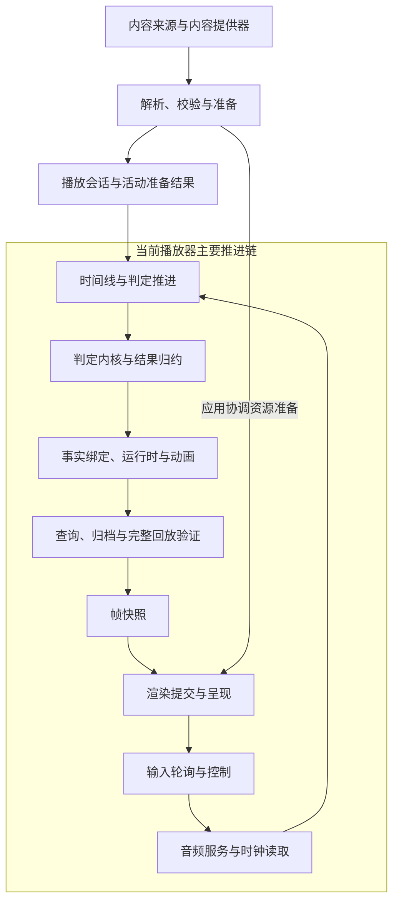
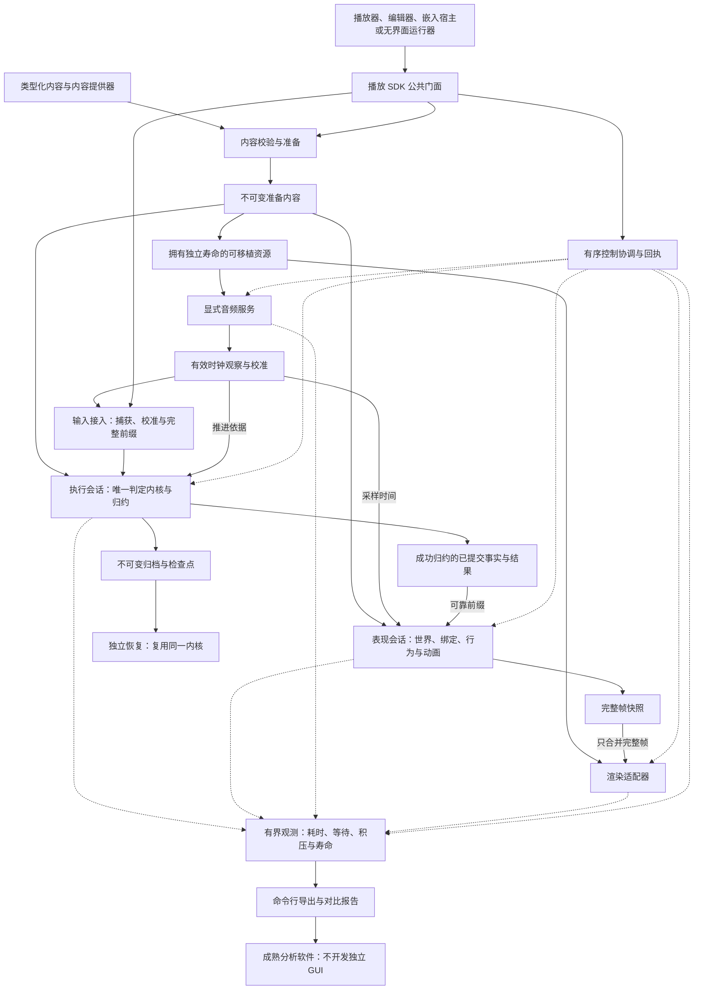

# Cuexis RPA 目标架构初步设计稿（讨论版）

状态：archived；v0.5讨论快照，不是现行实施计划或已接受架构。

归档日期：2026-10-10。

原路径：仓库根目录`rpa-target-architecture-draft.md`；归档前文件SHA256：
`d6ea8dfc4f905bdcf337df575a5fd99abe8dada80465db23509b049c12e1b938`。
本次仅增加归档说明并重定位Markdown链接，以下原稿正文保留。原稿中的“本次只维护此文件”、
推荐组合和M0–M6属于当时讨论背景，不再定义后续编辑范围或执行顺序。
现行范围、五方向比较及命名先行门禁归[RPA分册](../../stage_plans/active/stage-07/plan-rpa.md)，
当前状态归[CURRENT_STATUS](../../CURRENT_STATUS.md)。归档不代表本稿建议已接受、被全部否定或已实施。
按owner要求项目根目录不保留跳转文件；旧路径登记在[兼容映射](../../legacy-paths.md)。

---

状态：preliminary design v0.5；可用于整体审查的初稿，架构建议仍为候选，未冻结、未实施；明确用户约束单独记录。

日期：2026-10-10。讨论基线：`stage-7`，HEAD `2ddbcafe22bd3facc63b4917cf99eeccc3d81cd1`。

本文件由本次对话的直接请求创建，供反复商讨。它不是第二份 RPA 阶段计划，不改变现行 ADR、Spec、ABI、实施状态或授权。
本次仅维护此文件；后续修改先在此收敛，成熟后才讨论迁入正式文档。桌面接手文件中的行动清单只作为背景输入。
本稿引用的现状是上述基线的快照；后续仓库变化需要重新核对。

初稿的推荐组合：保留 SDK 公共门面与唯一 kernel/Fold；拆分不可变准备内容、执行状态和表现状态；
用显式时间/输入协议、安全推进许可和有序控制连接各 owner；独立管理音频供给；采用 owning 帧与资源发布；
整理日志、checkpoint 和结果共享；以命令行性能工具配合成熟分析软件提供证据。
本稿中的“推荐”“应”“必须”描述候选目标的约束，不表示已修改现行合同或获得实施授权。

| 阅读目的 | 位置 |
| --- | --- |
| 看总体方向与中文架构图 | 第 1–3 节 |
| 看数据寿命、时间输入、存储、表现与控制 | 第 4–11 节 |
| 看性能工具及长期维护边界 | 第 12–13 节 |
| 按协议和典型操作检查设计是否闭合 | 第 14 节 |
| 看未定项、迁移顺序与未来验收 | 第 15–16 节 |
| 看版本讨论记录及现行来源 | 第 17 节 |

已明确的用户约束：优先长期维护；本轮只做设计；只维护此独立文件；性能分析复用成熟软件，不开发独立 GUI；
排除强制指定可信 workflow 来源。时间 profile、同 Tick、Resume 语义、公开 API、容量及线程拓扑仍待裁定。

## 1. 目标与建议立场

建议把 RPA 从“现有播放循环的调度修补”深化为“内容、执行、表现、设备的职责重构”。
接受迁移和 API 调整成本，换取日后新增能力时能局部修改、独立验证、解释失败。
彻底程度以消除交叉职责和隐含约定衡量，不以新建多少线程、模块或类衡量。

维护目标：

- 同一个内容可以支持 Player、Studio、嵌入宿主和 Headless 验证，各自使用相同执行语义。
- 更换渲染器、音频后端或表现采样频率，不需要修改判定内核。
- 每个可变对象有明确 owner，跨域数据有明确寿命、版本和完成含义。
- 控制操作可以查明执行到哪一步；失败不会留下无法判断是否生效的状态。
- 热路径成本能按当前工作量解释，历史记录、读者保留和恢复成本能单独追踪。
- 新功能能说明需要修改哪个语义、哪个组件和哪些测试，减少通篇搜索与重复维护。

三类边界分开讨论：

| 类别 | 本稿处理方式 | 例子 |
| --- | --- | --- |
| 产品原则 | 继续保留 | 可嵌入 SDK；平台和 Runtime 内部化；单一 kernel/Fold |
| 需要修订的契约 | 明确提出候选修订，不偷偷改变 | 同 Tick 输入、暂停期间释放、时间 profile、表现寿命、公共准备对象 |
| 实现选择 | 在逻辑边界成立后选择 | 线程数量、队列实现、chunk 大小、checkpoint 周期、物理目录 |

GitHub 强制指定可信 workflow 来源已经按用户要求排除，不再作为 RPA 架构决策或阻断项。
本稿不执行产品重构、诊断码迁移、设备试验、保护修改、提交、PR、合并或发行。

## 2. 当前架构与现有 RPA 方案的评价

当前 Player 的主要工作仍串在同一个 owner 循环中：



这是职责与调用顺序的简图，不是所有模块的链接图；每步完整回放来自当前 Gameplay 测试桥，
不表示 SDK 要求所有宿主执行该流程。图中音频服务也不表示设备 callback 在应用主线程执行。

当前结构的优点是单 owner 易理解、已建立完整恢复语义、公开 SDK 隔离较好，已有测试可作为重构基线。
问题在于一个推进操作承担了过多职责：绘制等待影响供音与捕获，执行更新触发表现更新，查询可能复制完整结果，
每步完整 Replay 又把历史成本放进前台循环。增加 worker 可以缓解阻塞，但不会自动消除这些职责耦合。

定位依据：`app/player/src/player_gameplay.cpp` 当前显式测试桥的 T/H 增长及每步查询/归档/Replay；
`app/player/src/player_control.cpp` 的资源准备、audio service、输入轮询；
`engine/playback/src/playback_session.cpp` 的 Gameplay 推进和同步投影/Runtime 更新；
`engine/playback/src/gameplay_internal.hpp` 的 owning 结果构造；
`engine/judgement/src/execution_kernel.cpp` 的状态、ReplayData 和 projection 保留；
`engine/runtime/src/runtime_session.cpp` 的 RemainingFrames 消耗。
这些是代码结构观察，尚未构成 RPA 的新性能测量或设备验收。

现有 [ADR 0046](../../adr/0046-realtime-playback-coordination.md) 的优点是先划分五项责任，
区分捕获与交付，保留唯一内核，明确完整 frame 可合并而事实不可丢弃，并且没有提前冻结线程数。
它仍以现有 Prepared/Playback 组合形态为主要起点，较多问题留在跨域协调层解决。
如果长期维护优先，建议进一步拆开准备结果和活动会话，拆开执行与表现状态，并重新整理日志和公开结果。

代价包括公共接口迁移、恢复与 identity 修订、控制状态机复杂度、快照保留内存和跨平台输入验证。
这些成本可以接受，但需要逐项换来具体收益；不建议顺带重写已经成立的格式 Reader、动画算法或判定规则。

## 3. 目标结构：准备一次，执行与表现分别推进

下列名称是概念名，不是已选定的公共 C++ 符号或 CMake target。



实线表示主要数据/调用关系，虚线表示控制协调或观测。控制参与者的返回回执在图中合并表示。
每个框是逻辑职责，不等于新库、新公共对象或独立线程。

| 组件 | 独占的可变状态 | 输出 | 不承担的职责 |
| --- | --- | --- | --- |
| Content preparation | 准备过程的临时状态 | 不可变内容、资源描述、内容身份 | 活动 World、判定进度、设备状态 |
| ExecutionSession | 输入准入、timer、kernel/Fold、分支、提交游标 | 已提交事实、结果、归档、失败回执 | 动画采样、GPU、音频设备 |
| PresentationSession | World、绑定游标、动画、host override、表现效果 | 指定表现时刻的完整 frame | 生成 Hit/Miss、修改执行历史 |
| Audio service | transport、供音、设备生命周期、时钟观察 | 有质量与有效期的观察、控制回执 | 判定、渲染等待 |
| Renderer adapter | GPU 资源、提交、设备回收 | 指定含义的提交/呈现回执 | 访问活动 Execution 或借用 Prepared 内部视图 |
| Coordinator | 有序命令、参与者完成状态、控制 fence | 可查询的控制结果 | 第二套判定/时间规则、通用消息总线 |
| Recovery evaluator | 本次恢复的独立状态 | 完整 ReplayEvaluation / 重建候选 | 重入正在推进的活动会话 |

`PreparedContent` 包含规范化 typed 数据、准备好的程序和拥有寿命的数据，不包含运行中的组件实例。
代码只读不等于数据可跨线程：ContentProvider 回调、借用 view、销毁 owner 必须单独审核。
候选方向是准备阶段取得 owning 数据，活动会话以后只读这些数据；不把现有 Prepared 对象直接搬去 worker。

公共入口可以继续叫 `PlaybackSession`，作为组合门面协调这些内部职责。
当外部宿主确实需要独立准备、执行或表现时，再评估少量显式公共 handle。
内部组件数量不直接决定公开类型数量；内部 kernel/Recovery 图、Runtime、World 不进入安装 API。
SDK 不默认创建线程或设备；调度服务应由宿主显式配置或启用明确的可选适配器。

## 4. 所有权、寿命与版本

核心原则是“可变对象唯一 owner，不可变产物按明确契约共享”。不是所有对象必须永远属于同一线程。
对象创建、访问、转交和析构分别写清；允许转交时必须保证原 owner 已停止访问。
公共旧对象现有 owner 规则在修订接受前继续有效。

| 概念 | 回答的问题 | 不能替代什么 |
| --- | --- | --- |
| ContentIdentity | 内容与影响执行的配置是否相同 | 设备资源代数、执行分支 |
| ResourceGeneration | frame 需要的 CPU/GPU 资源是否匹配 | 判定进度、clock segment |
| ExecutionScope | 当前是哪条执行/恢复分支 | 普通 mutation generation |
| ClockSegment | 时间观察属于哪次连续设备/transport 区间 | 内容身份、已提交 Tick |
| CommitSequence | 哪个前缀已完成规定阶段的提交 | 尚未 Fold 成功的 sealed 前缀 |
| ControlSequence | 哪个控制操作及其完成状态 | 命令已入队、物理设备已切换 |

具体 wire 字段、比较规则、整数宽度和复用规则待审，不建议用一个全局 generation 承担所有含义。
时钟校准/profile 如果影响 canonical 判定轨迹，应进入相应执行身份；纯显示设置不因此进入判定身份。
内容重用不意味着共享可变判定状态、绑定游标、override 或设备 transport。

资源候选按真实依赖失效。普通 advance 不应让只依赖不可变内容的候选全部作废。
保留当前位置/当前执行状态的 reload 候选则依赖切换时的执行版本，应在 fence 处重新对齐或重准备。
资源标识不能作为忽略这些真实依赖的借口。

旧 owning 结果必须仍可读；旧 frame/resource handle 的 CPU 数据保留到最后读者释放，GPU 数据保留到设备不再使用。
析构线程与回收 owner 显式定义。重对象可转交 owner 回收队列，但 SDK 不隐藏一个后台回收线程。
读者长期保留所有旧结果必然增加内存；只能约束活动工作集，不能承诺总内存恒定。

## 5. 时间模型与执行许可

建议把时间桥独立建模，至少区分源采样帧/采样率、单调观测时刻、校准会话 Tick、H、表现 T、RuntimeFrame 和 F(H)。
现行各项语义仍以所属合同为准；本稿不重新定义 H，也不改 kernel 的 F(H) 公式。
适配层必须提交合法推进请求，并证明由该请求产生的封存边界不超过其输入完整性承诺。

音频观察候选字段：采样时的单调时刻、位置来源、采样率、segment、有效区间、误差/质量和欠载状态。
mixed、consumed 和 presented estimate 分开，不能把 coherent snapshot 等同于新鲜且精确的硬件播放位置。
44.1k/48k 与 Tick 换算使用明确的有理数关系和舍入规则；音频 offset、输入 offset、显示 offset 分属各层并各用一次。
缺少有效音频观察时，停止相关推进、显式选择已定义的无音频时钟或进入恢复；不得把失效位置继续当真。

完整前缀不增长时，安全门只阻止错误封存，不能单独保证播放体验。建议运行协调器公开至少四类可观察状态：`WaitingForInputPrefix`、`ClockObservationStale`、`ExecutionBacklog`、`QuiescingForRecovery`；状态包含原因、关联的时间/序号界限、已等待时长、音频实际位置和所需恢复条件。具体期限、滞后预算和是否允许无音频运行属于 profile/产品决策，必须经平台测量与用户体验评审后设定，不从测试注入值推导。

| 条件 | 即时动作 | 达到 profile 限额后的动作 | 恢复条件 |
| --- | --- | --- | --- |
| `F(H) >= B`，前缀暂不足 | 不封存该推进；保留已接受输入和现有 sealed/Fold 边界；继续接收并解决有界输入队列 | 若音频仍前进并使输入/执行偏差达到配置的停止界限，关闭新输入准入并请求音频暂停；等待设备实际停点回执，不把请求位置当实际位置 | 前缀补齐到所需完整界限，相关序号均已准入或明确拒绝，时钟观察仍有效，执行积压在配置范围内；重新建立映射/许可后继续 |
| 时钟观察过期、无效或 segment 不连续 | 立即撤销依赖该观察的推进许可；不沿用最后位置外推；记录失效 segment 和最后有效观察 | 请求音频 quiesce/pause；保持执行 cut 不动。音频停点未知时保持 `QuiescingForRecovery`，不得声称同步暂停完成 | 收到新鲜且连续或显式重建的新 segment 观察，确认设备实际位置；输入前缀和映射可证明后，由控制边界恢复 |
| 执行消费者积压，无法在预算内消费已可靠交付的连续前缀 | 对可靠输入/事实保留顺序和 owning 寿命；完整帧可合并，增量事实不可丢；发布积压量及最老年龄 | 先暂停低优先级表现采样/非必要导出；仍超限则关闭准入并请求音频暂停。不得以跳过事实、无限加内存或无界追赶解决 | 连续前缀追上或通过已证明的 checkpoint 重建追上，内存/队列回到配置范围，旧读者仍有效；控制协调器重新授予许可 |

限额必须区分软提示、请求停止和硬资源上限，且以单调时钟测量；音频暂停可能异步或失败，超限后的设备回执仍须报告为未知/失败。暂停期间新物理输入进入独立 trace，不会因为设备已停或队列暂时为空而自动成为完整执行前缀。停止音频不是回滚判定，也不改变已有 sealed/Fold 结果；若停止前已有未完成的执行 Tick，按第 6.2 节控制 cut 裁定。

输入时间建议先提供两种明确区分的 profile：

| profile | canonical 时间来源 | 前提与限制 |
| --- | --- | --- |
| Capture-time | ingress 捕获时取得的校准会话 Tick，交付时不重采样 | 不保证等于物理按键发生时刻；主线程未轮询期间的延迟仍存在 |
| Historical device-time | 有可信来源的历史设备时间，经有效 segment 映射 | 必须修订现行唯一来源规则，定义误差、时间域、迟到与完整性保证 |

推荐 Capture-time 作为可移植基础候选；是否能满足产品输入延迟要求由平台证据决定。
Historical device-time 作为独立候选，不允许仅凭一个平台 timestamp 就无条件回溯判定。
若时间可信度或映射有效区间不足，必须按 profile 明确拒绝、停止或降级；降级也要可观察。

推进需要 ingress 提供“已完整交付的输入前缀”，并说明它证明的是哪种捕获语义。
最后收到的事件 Tick、收到多少事件、队列暂时为空，都不自动证明一个时间区间已经完整。
Capture-time profile 可证明自身准入域中的捕获前缀；它不能证明历史物理事件已全部捕获。
历史时间 profile 还需要平台来源/延迟界限或其他可验证保证；没有保证就不能继续无界封存。
Headless 驱动可显式提供已知完整轨迹；这不是实体输入完整性的证据。

反例：渲染卡住 100ms，worker 已封存某个 Miss，随后主线程收到更早发生的按键。
增加 worker 并不能自动恢复正确性；必须由已声明的时间与 late-policy 决定拒绝、转发或停止，不能修改既有 sealed 结果。
100ms/500ms 只作试验注入值，不是已接受的生产容忍阈值。
音轨结束、设备停止和判定尾部完成也分开；音频不再前进时仍要有明确的尾判推进来源与停止条件。

## 6. 建议重审的输入语义

### 6.1 同 Tick 输入

建议正式支持“同 Tick 的多个不同 canonical subject”，解决低分辨率 Tick 或同时按键造成的真实碰撞。
这需要修订当前 execution profile；不是在 adapter 偷加 Tick，也不默认引入多指、fanout 或 Stage 7B+ 高级能力。
现有 capacity=1/fanout=1 的对象支持边界继续单独审核。

同 Tick batch 的规则分为三套，不共用一个“排序键”：

| 顺序 | 候选规则 | 目的 |
| --- | --- | --- |
| timer 执行顺序 | timer 按 execution profile 声明的内部阶段与稳定逻辑身份顺序处理；在输入 batch 消耗 capacity 前完成会释放该 capacity 的 timer 状态更新。不得据此推断所有 timer Fact 都排在所有输入 Fact 前 | 保持 timer 对输入可用性的既有关系，同时明确 timer 内部次序 |
| 输入竞争/仲裁顺序 | 先按 subject 分组；不同 subject 的同时输入整批参与容量/目标仲裁，以 canonical subject 和转换类别形成稳定顺序。相同 subject 的 press/release 按该来源单调 ingress sequence 解释；缺少可比较序号、出现重复转换或转换关系不合法时拒绝整个 Tick batch，不按线程交付先后猜测 | 支持和弦及普通快速 tap，同时不把竞态变成隐式优先级 |
| Fact 全序 | 每个产生的 Fact 使用独立规范键：逻辑 Tick、execution profile 明确列出的 ledger phase rank、timer/输入的稳定来源键、该来源内确定性 ordinal；同一输入可产生多个 Fact，按 ordinal 排序。该序列进入 Replay/恢复身份规则 | 规定持久化、digest 和重放看到的总序；不把输入仲裁顺序误当事实顺序 |

这些规则是面向基础 Player 可用性的候选选择，不是已接受语义。支持快速 press/release 必须验证内容/kernel 能表达同一 Tick 的转换序列及其判定结果；若现有模型无法表达，M0 必须明确选择升级模型或拒绝该 profile，不能静默把转换移到相邻 Tick。应为 `docs/formats/gameplay-v2-execution-profile.md` 的“一个 Tick 可有多个 timer 和至多一个 admitted input”增加明确替换条款：一个 Tick 可有多个 timer 和一个已关闭的输入 batch；不同 subject 可以并发仲裁，同一 subject 仅接受有可比较 source sequence 的合法转换序列；timer phase、输入仲裁和 Fact 全序分别适用上述规则。合同修订前，现行 `same_tick_collision` 仍生效。

### 6.2 Pause、Resume 与焦点

建议保留暂停期间真实物理转换的来源记录，并区分“物理接触状态”与“已准入判定状态”。
暂停可以停止执行时间，但设备仍可能收到 release、focus loss 或重新 press。
Resume 应有显式 reconciliation 操作，不能丢弃真实 release，也不能伪造一个看起来真实的事件。

建议把“执行输入 batch”和“暂停物理 trace”定义为不同记录域，并用 ingress 中的控制 cut 同时封闭二者的边界：

1. Pause 命令在 ingress 序列中取得 cut 序号。cut 前已接受的输入属于执行域；其所属 Tick cell 由 cut 显式关闭。关闭条件是 cut 前所有序号已有准入或拒绝结局，不要求 canonical Tick 再增长，也不要求暂停后的时钟继续运行。
2. 若 cell 内已有 press，完整 batch 在 cut 上包含该 press 并整体验证/仲裁；该 Tick 的 timer 和 Fact 按已选 profile 完成后才冻结执行 H。若 cut 前仍有未解决的较早 ingress 序号，则 Pause 处于等待 cut 结局状态；按第 5 节限额处理，不能把未解决序号当成空 cell。
3. cut 后的物理 press/release/focus 事件进入独立 PauseTrace，记录物理顺序、来源和可用时间证据，不推进执行时间、不改变判定 contact，也不能回写已关闭 batch。
4. Resume 必须先封闭 PauseTrace 并选择已裁定的 reconciliation 规则。候选默认是 trace 连续且无需改变判定状态时才直接续跑；否则要求显式 reconciliation、重新开始或拒绝 Resume。暂停期 release 不自动归属旧 Tick 或新 Tick；如 profile 允许转换为执行输入，需在 Resume 边界生成带 provenance 的 typed reconciliation batch，并明确 Hold 覆盖与 replay 编码。

这替换“暂停后靠 Tick 增长来关闭 cell”的任何解释；现行保持 held contact/Resume 不补 release 仍是当前合同，直至正式合同接受替换。

待裁定：暂停期间 release 是否只更新接触状态，是否在 Resume 的执行边界产生判定转换，
Hold 在该边界如何计分，focus loss 是否必须重建，以及恢复日志如何保留来源。
推荐输入 profile 定义 typed reconciliation 记录，并让同一 kernel 理解其被接受的语义；这仍是契约修订。
缺少可靠转换记录时，可选策略为重建/拒绝 Resume，不能假定所有键仍被按住。

## 7. 执行、日志与公开结果的存储

建议将存储分成四部分：当前活动状态、追加执行日志、checkpoint、不可变公开结果。
这使每次推进不必复制整个历史，也使查询不必重新构造全部 projection。
具体 chunk/共享方式与 checkpoint 周期待成本证据决定，不预设每个 Tick 保存完整副本。

日志保存可复现的事实：已接受输入、明确推进请求、控制边界和必要失败记录。
不能只保存 digest；完整 ReplayEvaluation、archive/cut/H、future pending、lastObservedTick 和恢复分支语义继续保留。
checkpoint 与所属 archive、cut、horizon、身份绑定，不能只凭位置命中。
恢复使用独立状态和同一个语义内核，不每帧在活动会话上执行完整 Replay。

发布链至少区分以下进度：

```text
Input accepted -> Kernel sealed prefix -> Fold committed prefix
               -> Public result published -> Presentation consumed -> Renderer receipt
```

kernel 已 sealed 不等于 Fold 已成功。表现只消费成功 Fold 的已提交前缀。
部分失败保留有效 sealed 前缀与实际工作 Tick；失败 Tick 不产生 token。
若进入 faulted，显示按现行契约冻结为只读，不能以“还有事实可用”为由继续改变画面。
公开结果分配失败与输入是否接受、kernel 是否执行分开记录；重试发布不能重复准入输入。

建议提交点保存一个可重复读取的不可变结果 handle，查询复用该 handle；不是让每次 query 重建 owning 全量结果。
新 snapshot 的构造成本、handle 拷贝成本和最后释放成本分别度量。
日志/chunk、结果 projection 与恢复载荷可以共享不可变片段，但不能隐式保留整个活动 RuntimeState。
大规模释放、恢复计算、磁盘 I/O 不进入音频 callback 或必须及时完成的提交路径。

历史成本按整个生命周期约束，不能以 handle 查询变快作为完成标准：

| 阶段 | 目标复杂度方向 | 验收证据与反例 |
| --- | --- | --- |
| 推进 | 对本次新输入、到期 timer 和实际状态变更按增量成本工作；不得每 Tick Replay 全历史或复制全量记录/活动状态 | 在固定新增工作量下按历史长度扩展，测量 p50/p95/p99、分配量和复制字节；查调用路径确认没有全 Replay/全量 projection clone |
| 生成新结果 | 只构造新增结果段及受影响 projection；允许可解释的边界复制，不随既有历史线性复制 | 增长历史但固定单次增量，测量发布耗时/分配/复制字节；对比完全相同的新结果语义 |
| 读取 | 读取 handle 元数据为常数级；读取所请求的 K 个事实/字段至多与 K 及必要索引成本成正比，不重建全历史 projection | 多次读取同版本结果的分配和耗时稳定；完整 ReplayEvaluation 仍可通过正式恢复/导出路径取得 |
| 恢复 | 从匹配身份的 checkpoint 恢复，成本与 checkpoint 大小加其后重放的增量成正比；无 checkpoint 时允许 O(N) 全量恢复，但必须隔离于实时推进并可取消/观察 | 覆盖 cut、pending、游标、失败与完整 ReplayEvaluation；比对从头恢复的语义结果，不只比 digest |
| 最后释放 | 活动路径只释放本次引用/新增片段；旧历史的大规模析构由明确回收 owner 承担，外部 handle 释放不应同步析构整棵历史 | 长历史与共享 reader 压测析构尾延迟/峰值内存；确认回收延迟有界且 shutdown 会排空或报告未完成 |

不可变共享只允许共享已提交的值、日志段或 projection chunk。任何共享节点不得捕获/持有 RuntimeSession、World、kernel 可变状态或能反向触达它们的闭包；否则读者只保留一个小 handle 也会延长整个 RuntimeState 寿命。验收需加入保留图/弱引用回收测试：释放最后一份结果后，执行状态、资源和历史段按所有权规则可回收；同时故意长期保留结果 handle，证明仅其明确引用的不可变数据仍存活。

分配失败需要可用的终态和最小回执；候选方案是为关键失败信息预留空间。
不承诺所有操作 allocation-free，预留范围和耗尽后的行为必须可验证。
长期保留、导出归档与裁剪不能改变仍有效的 owning 结果或已有 recovery cut。

## 8. 表现采样与反馈寿命

PresentationSession 接收完整的已提交事实前缀，在独立的表现 T 采样动画/Behavior/resolver。
事实输入及绑定游标可靠推进；生成的完整 frame 可以丢旧取新。
仅包含增量的 frame 不能使用相同合并规则。表现 T 变化不准产生预测 Hit/Miss。

建议 T 在音频观察有效且执行许可正常时跟随校准音频时间，不等每个事实才逐帧移动；否则正常的小延迟也会让整幅画面粘滞。但这意味着音符/动画可能先越过判定位置，随后才收到 Hit/Miss。为使该行为可审查，公开诊断至少报告 `audioTick`、`presentationTick`、`committedFactTick`、各自更新时间/segment、`presentationLead`、`factLag`、最老未消费事实年龄和当前处置状态。阈值均由 profile 裁定，不藏在渲染器常数中。

| 表现/事实关系 | 候选处置 |
| --- | --- |
| 事实新鲜且 T 未超已提交安全界限 | T 跟随音频；按完整事实前缀更新反馈 |
| 事实落后但仍在软预算内 | T 继续跟随音频；标记 `FactsDelayed` 并保留待显示反馈，不预测判定结果 |
| `factLag` 或最老年龄达到硬表现界限 | 冻结/钳制 T 到 profile 指定的最近安全位置并停止新的表现推进；触发执行积压策略。若积压仍增长，协调器请求暂停音频，使用实际设备停点建立后续映射 |
| 时钟失效或控制/scope 不匹配 | 丢弃不适用采样；冻结在最后合法完整帧，等待控制/时钟恢复，不使用陈旧数据继续动画 |

因此建议允许有限的视觉/事实暂时分离，但不允许无限分离：硬表现界限、执行积压界限和音频停止界限共同构成产品 profile；其中任一先到即可触发钳制与 quiesce。反馈仍只由已提交事实产生。

复用现有动画/resolver 算法，调整状态归属与调用边界，不维护第二套 Player/Studio 动画引擎。
新 frame 绑定 execution scope、控制版本和资源依赖；具体字段组合在接口设计时裁定。
renderer 获取 owning portable bundle，不再跨域访问活动 Prepared 的借用视图。
必要资源失败保留明确失败；GameplayOnly 是显式产品路径，不能成为自动掩盖资源错误的 fallback。

建议区分三类表现内容：连续状态、按时间到期的效果、需要首个可见机会的反馈。
现有 RemainingFrames 是按 Runtime 更新消耗，不是 GPU present 次数；兼容路径保持该语义。
新时间寿命需要新增/修订 typed contract，不直接替换旧枚举含义。

按会话时间到期的 Hit 反馈可能在渲染停顿中完全错过，这是可预测的时间语义。
若产品要求恢复绘制后至少有一次显示机会，建议把它定义为带稳定 feedback ID 的待确认呈现义务。义务不能在 frame 生成、进入 latest-frame 槽或排入 render queue 时完成；完整帧合并时未确认 feedback ID 必须合并到后继可呈现帧，直到成功回执、明确取消或超过 profile 最大年龄。

候选完成回执是 renderer 对包含该 feedback ID 的具体 frame 完成一次成功 present 操作后发出的 `Presented` 回执：含 frame ID、feedback ID、scope/control version、backend present result 和完成序号。仅成功构建、上传、提交 command buffer 或进入队列不足以完成义务；如果后端无法区分这些阶段与 present，应定义其最强可证明阶段并使用不同状态名。即便成功的 swapchain/present 调用通常也只能证明提交给显示系统的结果，不证明物理扫描输出或用户实际看见。设备丢失、过期和取消需有独立终态，不能伪报为已呈现。
控制切换、Seek、scope 变化取消旧效果，并从目标已提交投影重建绑定，避免旧反馈在新时间线闪现。

## 9. 有序控制与设备切换

采用一个窄的控制协议协调 Pause/Resume/Seek/Stop/reload/设备恢复/shutdown。
共享命令身份、状态查询、fence 和回执结构，各操作的语义分别定义，不以一个万能事务代替。
协调器必须由参与者报告结果，不能从“消息已发出”推断“切换已完成”。

```text
Requested -> Preparing -> Ready -> Quiescing -> CommitReady
          -> SwitchingDevices -> Committed

明确失败出口：Rejected / Cancelled / Failed
不可逆副作用后的失败：记录实际状态及需恢复/终止的结局
```

| 阶段 | 完成含义 | 关键限制 |
| --- | --- | --- |
| Preparing / Ready | 内容、资源和各 owner 候选准备好 | Ready 尚未活动；旧执行可继续 |
| Quiescing | 在明确控制 cut 停止越界准入，排空约定前缀 | 不能任意丢弃已接受输入或控制 |
| CommitReady | 执行/表现候选在 cut 对齐，确定性切换所需条件就绪 | 保留当前位置的候选需再次核验最新状态 |
| SwitchingDevices | 发起明确的物理切换并收集实际回执 | 音频与 GPU 不保证同时完成，硬件不保证可回滚 |
| Committed | 各必需参与者满足本操作的完成条件，允许新版本工作 | 新 frame、clock segment 和资源一致 |

内部确定性状态可采用预准备、预留和无失败交换，减少半提交状态。
它与物理设备激活必须分开描述；不能承诺软件意义的原子提交覆盖硬件。
每种操作要定义哪些设备激活前仍可取消，哪些副作用不可逆，以及实际 segment 和应用状态如何回读。
不可逆失败后返回明确的停止/降级/需恢复状态，禁止假装旧设备一定已经复原。

控制超时表示观察尚未完成，不代表命令被取消；使用命令 ID 查询结局。
fence 在必需回执齐备前不释放；显示可按操作冻结或等待，旧版本 frame 不得混入新会话。
控制队列可预留 shutdown/fault 容量，但不能越过语义上必须先完成的输入或控制。
shutdown 停止新请求、解决在途回执、解除设备 callback、在 owner 上清理并等待线程退出；不能靠 detach 掩盖寿命问题。

## 10. 通道、过载与线程部署

| 通道 | 交付策略 | 满载/落后时 |
| --- | --- | --- |
| Input / Control / Fault | 可靠、有序、显式接受回执 | 按合同拒绝、暂停或终止；接受后不可静默丢弃 |
| Committed facts / archive records | 可靠前缀、消费游标可观察 | 保留、回压或明确停止；不能伪装已消费 |
| Complete frame | 最新完整 frame 可覆盖未消费旧 frame | 保留必要资源寿命；不丢事实输入 |
| Clock observation | 同 segment 内按有效期取适用观察 | segment/失效转换可靠报告，不能只剩最新位置 |

实时 callback 不等待阻塞队列，不访问任意会话状态，也不执行恢复/重资源释放。
队列容量、超时和历史保留值需要测量与产品策略，当前不冻结生产数值，也不要求无锁。
先保证协议和失败可解释，再比较具体容器与同步方式。

推荐的部署方向：平台主线程保留 SDL 事件与 OpenGL，audio 有独立 owner；执行与表现逻辑可以先在同一 worker。
这不是把执行与表现职责重新合并：两个对象、推进接口和成本边界仍分开，以后拆 owner 不重写语义。
若最坏表现耗时仍会阻塞执行，使用同一协议将表现部署到独立 worker。
纯同步/headless runner 也使用相同准入、提交和控制规则，减少异步专属逻辑。

本地 SDL 头规定 PollEvent 和 GL_SwapWindow 为主线程调用；不能直接把现有 renderer 搬到任意 worker。
主线程同时承担 present 与 poll 时，输入捕获仍可能受 GPU 阻塞，audio/执行独立并没有消除这一点。
是否需要原生输入适配器、其时间与完整性保证，以及平台退化路径，属于后续独立设计和证据项。
不能承诺后台执行持续前进又始终拿到未延迟的物理输入。

## 11. API、兼容与模块组织

建议内部先形成清晰组件，再以实际外部用例确定公共最小接口。
现有 PlaybackSession 可以成为组合门面，旧推进调用委托给同一个 Execution/Presentation 实现。
迁移期允许薄适配层，禁止保留两套独立 kernel、动画或恢复核心。
适配层的存在期限和删除条件需要列入后续迁移方案，避免永久重复状态。

| 现有边界 | 候选迁移方向 | 必须说明的兼容影响 |
| --- | --- | --- |
| 组合 advance/update | 显式执行推进与表现采样，旧接口组合调用 | 默认顺序、错误映射、部分进度 |
| owner-bound PreparedPlayback | 新不可变 owning 内容/资源产物 | 新旧线程和析构规则；旧对象不自动可转交 |
| FrameSnapshot | 继续 owning，补全跨域依赖契约 | scope、资源、控制版本与旧 handle |
| RemainingFrames | 旧路径保留，新寿命另行声明 | 时间效果/首见反馈不重新解释旧数据 |
| Replay / Recovery | 按实际语义变化定义 revision | 旧 archive 拒绝、迁移或显式旧 profile；不能静默换含义 |
| 诊断码 | 正式域名与显式公共投影 | sourceCode、历史结果、严格校验、bytes/digest |

同 Tick、暂停 reconciliation、canonical 时间变化可能影响判定身份和恢复格式，必须单项列出替换条款。
正式命名迁移单列映射与验证，和架构线共享兼容审计，但不批量改写历史报告、fixture ID 或算法版本。
新公共能力通过明确 capability/profile 区分；不能把旧 archive 当成新语义轨迹继续解释。
SDK 版本由最终公开差异决定，不预选 patch/minor；内部重排本身也不自动要求公共类型增长。

逻辑上可归为 preparation、execution、presentation、coordination 与可选 device adapter。
物理 target/目录是否拆分，应看依赖门禁、可单独安装消费和编译成本；不机械地一组件一库。
继续复用已有 typed assembler/Reader、资源闭包、Result、动画/resolver 和架构 allowlist。
不引入通用 actor/plugin 框架、运行时脚本或每帧回调体系来承担本次协调。

## 12. 性能观测与验证工具

依靠成熟软件查看和分析性能数据，不开发独立 GUI。
这项是本稿的已确定设计约束；下面的事件字段、后端选择、运行器接口和验收方案仍为候选。

目标是让开发者能解释等待发生在哪里、哪些进度停滞、历史与读者保留带来多少成本，
并在相同条件下比较架构和版本。观测能力应随 RPA 一起设计，为线程选择和存储整改提供依据。
不另建性能面板、桌面分析应用或在线监控服务；运行器、导出和报告采用命令行及文件产物。

### 12.1 分工与复用

| 部分 | Cuexis 负责 | 外部工具负责 |
| --- | --- | --- |
| 观测事件 | 时间域、阶段边界、关联 ID、前缀进度与对象寿命的含义 | 时间线展示、筛选和通用查询 |
| 场景运行器 | 固定内容/输入/控制轨迹、负载与故障注入、运行元数据 | 系统层采样与设备分析 |
| 导出适配器 | 将已采集事件转换为选定工具接受的格式 | 文件读取与交互分析 |
| 回归分析 | 重复运行、版本比较、成本增长与完整结果核验 | 通用统计/绘图，必要时定位调用栈 |

时间线工具可评估 Perfetto；CPU、GPU、内存和线程调度分析复用适合平台的成熟 profiler。
具体版本、导出格式和关联方式在选型时验证，不把本稿的推荐写成已经集成或兼容。
领域事件与工具后端隔离：kernel/Fold 不依赖某个 viewer，也不向已安装公共 API 泄漏第三方工具类型。
默认产品构建不要求用户安装 profiler；额外采集与导出服务显式启用，由宿主或可选工具管理。

现有 FrameDiagnostics、动画/Playback 性能探针和 RPA 审查探针可作为输入。
保留各自 schema、用途和历史证据，定向复用场景与采集代码，不把 frame CSV 或历史 Debug 探针当作完整跨域时间线。
正式导出适配器遵循现有模块依赖规则；JSON 导出如果采用项目 JSON 支持，不在执行模块另引 JSON DOM。

### 12.2 观测内容

| 领域 | 候选事件/计数器 | 用来解释的问题 |
| --- | --- | --- |
| 输入 | capture、enqueue、delivery、admission/rejection、完整前缀认证 | 是捕获延迟、交付等待还是准入拒绝 |
| 执行 | kernel/Fold 工作区间、sealed/committed/published 前缀 | 谁耗时，哪个阶段尚未完成 |
| 表现 | fact 消费、binding、animation、snapshot、frame 合并/取消 | 表现工作量、执行落后与旧帧淘汰 |
| 音频 | service/callback、queued frames、underrun、clock 观察与 segment 变化 | 供音是否及时，观察是否有效/过期 |
| 渲染 | 资源准备、CPU submit、present 调用等待、适配器回执 | CPU 工作与设备等待分别占多少 |
| 控制 | 命令请求及各阶段进入/退出、fence 等待、取消/失败 | Seek/reload 卡在哪个参与者 |
| 通道 | 深度、高水位、最旧记录年龄、拒绝和已消费游标 | 是瞬时突发还是持续积压 |
| 存储 | 逻辑保留字节、分配/复制量、handle/chunk 保留、回收耗时 | 历史增长和读者寿命造成多少成本 |

事件候选字段为 schema revision、单调时间、owner/线程标识、事件种类、操作关联 ID 和必要版本信息。
按事件携带 input sequence、commit sequence、frame ID、control ID、execution scope、resource generation、clock segment。
同一次输入或控制跨组件传递时沿用关联信息，使时间线能展示完整过程；字段集合与 ID 生命周期待裁定。
单调耗时与 canonical Tick 分开记录，单位明确；转换关系和误差可观察，不从 Tick 差推算 CPU 耗时。
CPU 调用结束不当作 GPU 执行完成；没有可信物理时间来源时，不报告物理按键发生到捕获的延迟。
逻辑保留字节、allocator 统计和进程 resident memory 分开，不能靠 RSS 差推断某个对象的精确占用。

### 12.3 采集成本与失败边界

候选模式为关闭、低成本计数和详细 trace，分别测量启用后的额外成本。
热路径只记录有界数据，不同步格式化大型字符串、遍历完整结果或写磁盘。
callback 不等待采集队列、不分配重对象、不执行恢复；采集缓冲、排出和析构的 owner 显式定义。
优先按 owner 写入预留缓冲，由显式服务排出；容量、覆盖策略和后端并未冻结，也不先要求无锁。

性能 trace 容量不足可以按已声明策略丢采样记录，但必须记录丢失计数、覆盖时段或不完整状态。
计数器如果也不能可靠保存丢失信息，该次证据应判为不完整，不能默认为零丢失。
trace 丢失不等于允许丢输入、控制、Fact、archive 或 Replay；两类通道不共享可靠性承诺。
采集/导出失败不改变判定状态；场景报告单独标明观测失败，不把失败结果写成性能通过。

观测信息不进入 canonical identity，不参与判定或推进许可的生成。
采集仍可能扰动调度，进而改变实时捕获轨迹；因此不能无条件承诺开关观测后实体输入结果相同。
校验使用固定的 canonical/admission/control 轨迹，对比完整结果，并另外报告真实实时运行的观测开销。

### 12.4 场景、产物与回归

运行器应支持固定输入/控制脚本和可控时钟，组合不同谱面密度、时长、表现负载和旧 handle 保留量。
分别注入渲染停顿、捕获后延迟交付、捕获停顿、慢 Fold/表现、队列满、分配失败及设备失效。
模拟场景不能替代物理设备证据；fake clock 用于驱动语义，性能耗时仍由真实单调时钟测量。
无观测基线、计数模式与详细 trace 分开运行；冷启动、预热和稳定运行分开报告。

每次运行的候选产物：

- 运行 manifest：commit/工作树差异、构建配置、机器/设备/工具版本、内容身份、profile、seed、轨迹和采集配置。
- 原始 trace 与计数器：明确时间域、缺失状态、工具格式版本及对应运行身份。
- 汇总与版本对比报告：样本数、重复次数、p50/p95/p99、最大值、deadline miss、积压和内存增长趋势。
- 语义校验结果：完整 ReplayEvaluation/结果比较、fault terminal；digest 仅作索引，不代替完整核验。

样本不足以支持尾部分位数时明确标注；未观察到某延迟不等于它不存在，最大测量值也不是最坏情况保证。
回归比较绑定相同工作量、构建/硬件条件与轨迹，不能仅比较一个 FPS、一个平均值或不同负载的总时间。
先积累 Release 基线与机器内重复性，再裁定容忍度；不在共享 hosted runner 上贸然设置硬性毫秒门禁。
性能阈值、长期采集容量和生产 deadline 均保持待定，不能把故障注入数值转成生产预算。

首期建议包含事件模型、关键边界埋点、场景运行器、成熟工具导出和命令行对比报告。
在线服务、独立 GUI 和自研通用 profiler 不进入范围。
验收先验证导出能被所选成熟工具读取、关联链可解释、采集开销/缺失可见及固定轨迹语义不变；
随后用同一方案测量重构前后，覆盖长历史、持有旧结果和真实设备。以上均未实施或执行。

## 13. 模块边界、会话管理与恢复细化

本节继续细化其他架构部分，全部是候选设计。公共类型名、状态枚举和 ABI 未冻结。
既有 SDK 契约在正式修订前有效；本稿不把新读端口、命令重试或跨 owner 准备能力当作现有功能。

### 13.1 依赖方向与公共入口

推荐保留一个清晰的 Playback 公共入口，内部通过构造时显式提供的窄接口组装。
应用负责平台/设备选择与服务启动；协调器负责跨组件控制顺序；各组件拥有自己的状态。
不使用全局当前会话、可变服务定位器或任意字符串 topic 的通用事件总线。
结果返回、订阅和调用关系必须能从接口追踪，避免把编译期依赖隐藏成无法审核的运行时依赖。

| 逻辑组件 | 可依赖的职责 | 不应产生的依赖 |
| --- | --- | --- |
| 内容准备 | typed Reader、编译、内容供给与资源闭包 | 活动执行会话、设备控制、协调器 |
| 确定性执行 | 不可变执行内容、现有 kernel/Fold、执行值类型 | 表现会话、音频/图形设备、平台时钟 API |
| 表现 | 不可变表现内容、已提交公开投影值、现有 Runtime/动画 | 直接操作活动 kernel、设备 transport |
| 协调 | 各参与者的命令/回执接口、内容候选 | 复制判定规则、读取 World 私有状态 |
| 设备适配 | 可移植资源/帧、平台 API、设备专用状态 | 修改判定历史、反向控制内部 Runtime |
| 观测/导出 | 轻量观测值、离线归档格式 | 被 kernel 强制依赖的 viewer 或文件服务 |

这里描述编译/访问方向，不能从数据流箭头推断链接依赖。
表现消费的事实/结果契约应放在能被双方引用的窄类型边界，不能因接收结果而链接整套恢复引擎。
先使用现有模块中可满足隔离的类型；确实需要新内部 target 时再加入 allowlist，不建立无边界的 common 库。
异步、设备和观测边界需要接口；纯内部计算优先普通类型和函数，避免每个类都配抽象基类。

候选公共使用面分为三类，不要求宿主取得每个内部组件的指针：

- 控制面：owner 上的同步操作；可选的跨线程命令端口仅提交拥有数据的请求并返回票据。
- 读取面：取得已发布的 owning 状态/结果/frame；可选读端口读取发布值，不调用活动 World 或 kernel。
- 驱动面：宿主显式供给时间与输入，或者显式启用配置好的运行服务；每个可变对象仍只有一个 owner。

直接方法不因存在命令端口而变成线程安全。公共异步端口若引入，需独立审核其对象寿命、关闭行为和安装兼容。
宿主回调不默认允许重入会话；读取某个旧 snapshot 不代表整个会话在此刻具有同一状态。
诊断/状态 snapshot 应标注采集版本和参与者进度；控制协调只依赖可靠回执，不能依赖混合时刻的统计视图。

### 13.2 生命周期、播放意图与健康状态分开

建议内部用少量正交状态描述系统，公共层提供明确定义的组合摘要。
避免一个枚举混合“已加载、暂停、设备丢失、正在重载、结果发布失败”而产生大量组合状态。

| 状态维度 | 候选取值/内容 | 回答的问题 |
| --- | --- | --- |
| 会话生命周期 | Empty、Active、Closing、Closed | 是否有活动内容，是否还接收操作 |
| 播放意图 | Prepared、Running、Paused | 用户是否要求推进；不等于当前一定获准推进 |
| 执行健康 | Healthy、Faulted，并保留 Kernel/Fold/Control 来源 | 判定链是否还允许执行 |
| 推进许可 | 输入前缀、时钟有效性、控制 fence、容量条件 | 本次推进的全部条件是否满足 |
| 设备/表现可用性 | 各参与者 Ready、Unavailable、Recovering、Failed | 哪个输出或服务暂不可用 |
| 控制操作状态 | 第 9 节状态机与命令回执 | 某条命令到哪一步 |

当前 SessionState 和 Gameplay 状态继续按现行 API 映射；上表是内部建模建议，不能直接替换公开枚举。
候选内部 Closed 表示本运行实例已结束；现有 unload 仍是清空内容，不能静默变成永久关闭。

需要保持的组合约束：

- Empty 没有可推进的执行实例；候选正在准备不等于活动内容已改变。
- Running 是意图，时钟失效或输入前缀不足仍应阻止相应推进。
- Faulted 不因设备恢复而回到 Healthy；按现行规则只允许 owning query/archive、reset/unload 或完整替换。
- 结果/投影/Runtime 发布失败不自动转成 kernel/Fold 故障；记录各已完成前缀与旧画面。
- Paused 下判定时间不推进；物理接触记录与 Resume reconciliation 仍等待 D04 修订。
- Closing 拒绝新业务请求，仍接收完成关闭必需的回执；已导出的 owning 数据遵守原寿命契约。

反例：音频设备丢失但最后一次 Fold 已成功。此时应阻止依赖失效时钟的后续推进并处理设备恢复，
不能清空分数，也不能为了保持 Running 外观而继续使用旧时钟。

### 13.3 命令回执、顺序与有限重试

推荐同一会话中最多一个改变活动组合状态的控制操作进入提交阶段。
无副作用的内容准备可并行，但切换顺序由协调器串行裁定；所有候选提交前重验实际依赖。
高频展示设置可以按明确规则合并；已接受的输入、Seek、Stop、reload 不允许默认丢旧取新。

命令概念字段包括 session incarnation、command ID、请求序号、操作类型、预期 scope/config revision 和拥有的数据。
incarnation 区分完整运行实例的替换；不能把上一实例的相同数字 ID 当成本实例操作。
接收回执必须区分 Rejected 与 Accepted；Accepted 只表示系统负责给出终态，不表示操作已应用。
终态报告包含实际应用版本、控制 cut、必需参与者回执和稳定错误原因；不从 timeout 推断 Cancelled。

建议提供有界的命令去重/结果保留窗口：同一 ID 与相同请求在窗口内返回原票据/结果，不再次执行；
同一 ID 携带不同请求拒绝。过期 ID 返回明确的过期/未知结果，不自动作为新命令执行。
因此无法确定旧命令是否完成时，先查询活动版本和保留回执；不能用新 ID 盲目重发非幂等操作。
保留容量、确认释放方式和 session 内 ID 不复用规则待定，不承诺无限期 exactly-once 或跨进程恢复。
控制票据去重不替代输入准入序列规则；已接受输入重交仍按正式 Gameplay 合同处理。

取消也是有回执的请求。提交前可取消的候选应释放未活动资源；跨过不可逆设备动作后可拒绝取消，
或转入明确补偿/停止流程；不能同时宣称 Cancelled 又使用该候选继续运行。

### 13.4 内容替换、配置与缓存

内容编辑、执行配置和表现偏好按影响分别处理，推荐将变更分类写成方法级矩阵。

| 变更种类 | 候选处理方式 | 必须维持的边界 |
| --- | --- | --- |
| 改变判定内容或语义配置 | 新身份、重新准备并显式重建执行 | 不能沿用旧评分或静默解释旧 archive |
| 仅改变表现内容/资源 | 重建表现候选，在控制 cut 重新绑定后切换 | 保持既有判定四分量，但不能复用失效 target/resource |
| 视口等纯展示设置 | 表现 owner 上按版本更新，必要时更新设备资源 | 不改变判定身份；实际影响输入映射时重新分类 |
| 输入绑定、校准、时间 profile | 按语义配置审查，记录生效边界与身份影响 | 不作为普通 UI 设置热改 |
| 音频/图形设备或格式 | 设备重准备与激活回执，更新 segment/资源依赖 | 不假定相同位置或相同名称代表同一连续区间 |
| 观测级别 | 独立配置 revision，显式启停采集 | 不改变 canonical identity，开销仍需报告 |

“保留时间位置”只说明 transport/表现定位意图，不自动意味着保留分数、held contact 或执行分支。
reload 操作必须声明保留哪些状态；保持判定需证明执行身份未变且符合原契约。
新版准备产物分为可复用内容产物和在控制 cut 绑定的活动候选；后者由相关 owner 构建并提交。
准备 job 取消后到达的旧结果通过请求/候选身份拒收；job 清理不提前释放仍在使用的数据。
ContentProvider 的读取线程和寿命继续显式声明，不能因为采用 job 就并发调用原本只允许 owner 调用的 provider。

缓存建议分为不可变 CPU 产物缓存与设备资源缓存，由明确服务管理，避免全局缓存隐式延长会话寿命。
CPU 键覆盖内容、编译/准备选项和相关版本；设备缓存还绑定设备实例、格式和后端条件。
输入闭包未完成验证时不能直接信任 cache hit。缓存淘汰仅释放缓存持有的引用，不使活动 lease 突然失效。
容量与回收策略待测量，先明确谁持有、谁释放、在哪个 owner 释放，再选具体淘汰算法。

### 13.5 慢消费者、追赶与保留预算

执行发布必须提供明确的连续提交序号，表现消费者记录已成功消费的游标。
应区分三类数据：可由最新投影重建的状态、必须逐条消费的语义事实、具有显示机会要求的反馈。
不能因一张最新画面存在，就认定遗漏的 binding/history/feedback 已被处理。

消费者落后但记录仍在时，按连续批次追赶；批次大小可调，但不能跨过缺口伪报消费成功。
如果未来允许从 checkpoint 跳过旧段，必须携带该段所有累积绑定效果、去重状态和反馈处置的重建证明。
仅有分数或当前 World snapshot 不足以证明这种跳跃等价。
初期建议未验证重建协议前采用可靠保留和明确 backpressure/容量拒绝，不引入静默跳跃优化。

实时模式不能无限期等待慢表现而不处理音频仍在前进的问题。
建议达到预算边界时触发明确的协调暂停/失败策略，记录实际设备停下的位置和时钟有效范围；
所需容量预留、停音等待期间的输入处置及最终结果由过载/profile 契约裁定。
纯观测消费者允许报告丢记录；表现和 Replay 消费者不能套用这个例外。

内存预算分别追踪活动状态、待消费日志、归档/checkpoint、公开读者保留、设备资源与观测缓冲。
归档写盘或长期存储不属于实时提交路径；要求可恢复时，不能在落盘前就当作已持久化。
现有 owning 结果不能被强制失效来“回收预算”。受限环境可拒绝新的保留/导出请求或停止会话，
但这些必须是新接口明确约定的行为，不能静默删掉旧 handle 仍引用的数据。

### 13.6 故障隔离、恢复与关闭

| 失败位置 | 默认候选处置 | 不应发生的连带行为 |
| --- | --- | --- |
| 候选内容准备/资源校验 | 拒绝候选并保留旧活动状态 | 为腾空间先破坏旧资源再报告失败 |
| 输入/控制预检 | 返回未接受，保留原状态 | 已拒绝却改变游标或时间 |
| Kernel/Fold | 保留合法 sealed/committed 边界，进入对应故障状态 | 修改已封存结果、从设备恢复推断判定已恢复 |
| 结果/表现发布 | 保留执行进度及旧发布值，报告具体失败阶段 | 重交输入以重试发布 |
| 音频失效 | 撤销对应时钟的推进许可，显式恢复或停止 | 无记录切换时间源、清空分数 |
| 图形失效 | 冻结/重建设备资源，按显式运行策略协调暂停 | 自动退成 GameplayOnly、默认 fault 判定 |
| 观测/导出 | 标记证据缺失，隔离观测故障 | 因 trace 写失败而篡改业务结果 |

可恢复不等于自动重试。恢复请求需说明重建对象、有效时间范围、要保留的结果和新的 scope/segment。
图形失效后是否允许继续执行是产品策略；交互 Player 建议协调暂停，已显式选择无图形的宿主可按其能力继续。
GPU 上下文丢失也可能让“冻结旧画面”无法实际显示；保留的是最后发布的只读数据，不能承诺屏幕仍显示它。
普通 Result、稳定故障回执与进程级 Fatal 保持不同；预留失败槽也不承诺在任意 OOM 下可安全恢复。

候选关闭顺序：停止接受新业务请求，解决或取消在途控制，停用设备并等待 callback 不再访问数据，
排空/终结各 owner 的任务与回执，完成设备资源回收，再退出显式创建的工作线程。
不能阻塞平台主线程去等待一个又需要主线程执行任务的关闭流程；必要时由主线程分步驱动关闭。
超时后报告未完成并保留仍被访问的所有权，不能提前销毁资源、detach 线程或假称 Closed。
已经返回给宿主的 owning CPU 结果可按合同晚于活动会话释放；其释放不能调用已经销毁的 World/设备。
设备资源的回收服务必须活到最后设备使用结束；公共帧不暴露需要任意宿主线程直接析构的 GPU 对象。

### 13.7 以变更场景检查可维护性

这些场景用于检验职责边界，不代表 RPA 实施所有功能：

| 将来的变更 | 应主要修改的部分 | 若发生则说明边界仍有问题 |
| --- | --- | --- |
| 更换图形后端 | 渲染适配与设备资源准备 | 必须修改 kernel/Fold 或输入时间定义 |
| 新增音频后端 | 音频适配、观测来源与设备恢复 | 必须重写表现绑定或复制判定逻辑 |
| 增加判定能力 | 已授权的判定语义、typed 内容与测试 | Player、Studio 各实现一份同名规则 |
| Studio 多预览 | 多个独立会话，共享明确可复用内容 | 全局当前会话、设备或缓存串扰 |
| 长时间运行成本整改 | 日志/checkpoint/回收及采集验证 | 为提速悄悄更改 owning 寿命或 Replay 含义 |

推荐用这些场景做依赖审查和未来定向契约测试；不为目录结构本身添加镜像测试。
本节不扩展 Stage 7B+ 的能力范围，也不提前承诺 Studio、其他图形后端或新设备实现。

## 14. 协议轮廓与完整使用流程

本节给出可审查的初步协议，不是可直接落地的头文件或 wire schema。
重点是对象包含的信息、访问者与完成条件；具体字段宽度、命名、编码和稳定错误码在 typed review 时确定。

### 14.1 协议对象与最小操作面

| 候选对象 | 最小信息 | 写入者与消费规则 |
| --- | --- | --- |
| 准备内容 | 内容身份、执行配置身份、typed 程序、资源闭包、相关版本 | 准备完成后不可变；活动状态另建 |
| 时钟观察 | 来源、单调采样时刻、源帧/采样率、segment、状态、有效期与误差 | 设备/宿主适配发布整体观察；消费者不能拼接更新 |
| 输入批次 | 来源与顺序、canonical Tick/subject、捕获 provenance、映射版本、segment | ingress 确定时间；执行方验证与准入，不在取队列时重采样 |
| 前缀证明 | 时间域与 segment、完整性界限、已交付序号、证明方式 | ingress 声明；scheduler 在对应序号全部解决后才使用 |
| 推进请求 | 精确 H、时钟观察引用、适用前缀证明与控制版本 | 执行 owner 调用，回执记录请求及实际完成边界 |
| 提交视图 | scope、commit sequence、成功 Fold 前缀、owning 结果/事实段 | 提交后发布；查询复用句柄，不重新遍历全历史 |
| 表现采样请求 | T、RuntimeFrame、viewport、消费前缀与控制版本 | 表现 owner 验证后采样，不更改 canonical 历史 |
| 帧封装 | owning frame、采样时刻、scope、资源版本、控制版本、结果前缀 | renderer 只接收与已激活资源/控制相符的帧 |
| 控制票据与回执 | 实例/命令身份、阶段、实际 cut、应用版本、参与者完成情况 | 协调器汇总；未完成、失败与未知有不同结果 |
| 恢复请求 | 归档、明确 cut/H、身份与 revision、目标控制意图 | 独立评估产生候选；不修改当前活动状态 |

初稿建议的操作轮廓如下，名称仅作说明：

```text
准备：prepareContent(source, options) -> 内容候选或拒绝
切换：requestControl(command) -> 已接受票据或拒绝
查询：readControl(ticket) -> 阶段或终态
输入：submitInputs(batch) -> 准入回执
执行：advanceExecution(request) -> 执行与发布分阶段回执
表现：samplePresentation(request) -> 完整帧或发布失败
结果：readPublishedResult() -> 版本化 owning 结果
归档：captureArchive(cut) -> 拥有寿命的归档视图
恢复：prepareRestore(archive, cut, H) -> 独立恢复候选
关闭：requestClose() / pollClose() -> 可观察的关闭进度
```

直接调用在 owner 上执行；跨线程命令端口仅负责传递 owning 请求，不能绕过 owner/reentry 检查。
同步参考驱动与异步 Player 复用上述语义。显式运行服务内部驱动的 owner 不允许宿主同时手动推进。
不承诺上述每项都成为新的公共方法：公开最小组合由 D10/D12 决定。

### 14.2 时间域与输入完整前缀

建议所有时间字段使用不同的语义类型：单调时间、源音频帧、设备帧、canonical Tick、H、T 分开。
不可变映射描述包含源锚点、目标锚点、有理数比例、offset 归属、适用 segment/区间和 profile revision。
运行期映射实例 ID 用于关联；影响 canonical 语义的规则进入相应身份，二者不混同。
带越界检查的算术、舍入方向、负值和极值处理统一由时间转换边界负责，不能散落在 Player、Audio 和 Gameplay 中。

前缀证明建议用“严格小于界限 B 的当前 profile 输入已经完整交付”表达，避免含糊的“到 B”。
它必须同时绑定已交付序号 S；控制/执行 owner 尚未解决 S 之前，不得利用该证明推进。
普通有限 B 下，只有当现行 F(H) 严格小于 B，且时钟、控制和准入条件均满足时，才允许相应封存。
不在适配层把 F(H) 改成 B，不把已知最大事件 Tick 直接当作 B，也不在整数最大值处盲目计算加一。
有限边界、未知边界和来源结束需要显式类型；来源结束也不自动代表所有 Gameplay timer 已完成。

Capture-time 候选以成功捕获并关闭的 Tick cell 为完整性单位：同一 Tick 仍可能接收事件时不得提前封窗；Pause 等控制 cut 可按第 6.2 节用 ingress 序号显式关闭当前 cell，无须 Tick 增长。
若支持同 Tick 批处理，应缓冲该 cell 的事件并在关闭后整体验证；不能用消费线程调度先后来裁定批内胜者。
不同 subject 的顺序候选为现有结构化 canonical key 的全序，不以指针、hash、队列到达顺序排序。
具体 timer/input/仲裁顺序仍需 D03 的规范修订，不能仅排序后重复调用当前“每 Tick 至多一个输入”实现。
在单个单调 segment 内，未来捕获不能再声明小于已证明界限的 Tick；若映射无法维持，应停止证明并进入显式恢复。

多个输入来源由应用声明参与集合；聚合前缀取这些来源在相同有效时间域内的共同完整部分。
增加/移除来源需要控制边界；设备失联不能通过悄悄移除该来源来伪造完整性。
同一会话的准入排序由明确的 ingress 合并器承担，队列交付顺序不能自动成为 canonical 排序。
这仅支持基础多来源接入，不默认扩展多指/多资源判定能力。

例：输入序号 41 已捕获但未交付，序号 42 的前缀证明先到。执行方必须等 41 的准入或明确拒绝结局；
不能因证明带有更新的时间而先封窗。若来源本身尚未捕获物理事件，Capture-time 证明也不能回溯证明其物理时间。

### 14.3 调度、工作预算与正常结束

建议调度以已就绪工作与显式截止条件驱动：输入到达、timer 到期、控制回执、时钟更新和表现请求分别唤醒对应 owner。
同 owner 中执行与表现分别安排工作；已到期执行不能被无界表现积压永久饿死，控制完成与关闭也需要服务机会。
具体优先级和最大工作量由平台测量决定，协议不依赖某个固定刷新率。

调度预算只决定何时发起下一次合法请求，不允许在 kernel/Fold 的原子边界中途对外宣告成功。
如果要把很大的推进拆成多个精确 H，请求与各次 admission/control 顺序必须进入日志并接受现有等价条件检查。
目前不发明半 Tick 可恢复状态，也不把实际未处理完的 H 写成成功 horizon。
消费者落后达到边界时使用第 13.5 节的显式处置，不能靠无限追帧抢占供音或无限增长内存。

无音频模式由宿主显式选用会话时钟；暂停期间不累计执行时间。音频自然结束后可采用显式的尾段时钟策略，
其起点、速度、输入接收期限和 timer 结束条件需由 profile 定义并记录；它与设备失效后的自动 fallback 不同。
推荐区分 AudioEnded、ExecutionComplete、PresentationComplete 和 ArchiveExported 四种完成信息。
只有已处理全部规定工作、终止输入边界已解决、最终 horizon/cut 已确定且结果发布成功，才能声明执行完成。
没有足够时间/输入证据时保持未完成或失败，不凭音乐停止强行生成最终结果；提前关闭记录实际 cut 及未完成原因。

### 14.4 首次加载与开始播放

1. 宿主明确选择内容、执行 profile、时间模式、设备能力与 GameplayOnly/Presentation 意图。
2. 内容准备验证闭包并生成不可变产物；在合法 owner 上取得资源，构建执行、表现和设备候选。
3. 协调器检查所有必要候选及其依赖，建立初始 scope/控制版本；Ready 仍不等于已经播放。
4. 所有参与者完成相应激活；新 frame 只与新资源组合，开始推进需要有效时钟和输入前缀。
5. 用户的开始请求取得明确回执；图形、音频与执行实际开始点分别可观察，不承诺硬件同时起动。

首次加载失败没有活动会话可保留，返回 Empty 或明确终态；替换加载失败则尽可能保留旧活动组合。
物理激活后失败按不可逆边界报告，不能套用纯 prepare 失败的“完全未变”保证。

### 14.5 Pause / Resume 端到端流程

Pause 候选流程：

1. 在 ingress 的输入/控制顺序中分配 Pause cut 序号；cut 前记录属于执行 batch，后续物理转换进入独立 PauseTrace。按第 6.2 节解决 cut 前序号并显式关闭当前 cell，不等待 Tick 增长。
2. 执行 owner 完成该 batch 所需的原子工作并冻结可验证的执行 cut、H 和各阶段前缀；若存在未解决的 cut 前序号则保持等待/恢复状态，不为追音频强行跨过未知输入。
3. 音频 owner 执行暂停并报告实际停止位置和有效性；表现冻结最后已发布画面，协调器核对差异。
4. 满足操作定义的必要回执后返回 Paused；报告请求位置、执行位置和设备实际位置，不假装三者必然相等。

如果暂停过程有设备超时，返回未完成或失败阶段，保持推进许可关闭；不得用 Requested 位置冒充实际停住的位置。
允许暂停后音频重新定位以对齐执行 cut 是候选设备策略，必须报告差异并取得新的映射观察，不暗改已提交判定。

Resume 的初步推荐是采用保守默认，并为后续明确的 reconciliation profile 留出类型边界：

- 只有 trace 连续、映射有效、需要保持的接触状态没有不一致且设备已准备好，才允许直接延续。
- 暂停期间存在相关 press/release/focus 变化或 trace 不完整时，不自动补输入；返回“需要明确恢复策略”。
- typed reconciliation 被正式裁定后，才允许按该 profile 处理真实转换；需明确事件时间、Hold 覆盖、同 Tick、迟到和身份影响。
- 当前无法解释的轨迹由宿主选择明确 reset/重新开始或合法恢复路径，保留旧 owning 结果；不静默丢弃转换。

这将 D04 的候选收敛为“安全默认 + 可审查扩展”，仍需用户裁定产品体验。
相同的最终键状态不能替代完整 trace：暂停中释放再按住，可能与一直按住具有不同含义。
实际 Resume 在新映射/segment、恢复前缀和必要设备回执成立后才开放推进；直接保持同段需有明确连续性依据。

### 14.6 Seek 端到端流程

1. 请求明确指定 archive、cut/H 与恢复后的播放意图；仅有浮点时间位置不足以构造合法判定状态。
2. 独立恢复任务验证身份/revision，沿唯一 kernel/Fold 生成目标候选，恢复完整 pending、lastObservedTick、准入去重与相关游标。
3. 表现候选依据恢复后的成功 Fold 投影重新取得当前合法绑定和资源；准备目标音频/图形候选。
4. 协调器建立当前活动分支的切换边界，解决边界前已接受操作，停止跨边界的新准入；旧内容可在此前继续运行。
5. 在依赖再次验证后切换 scope、消费者游标、去重、绑定、token 和资源；设备切换取得实际回执，拒绝旧 scope 的迟到 frame/结果。
6. 发布新组合及回执，再按请求的播放意图决定保持暂停或重新获取推进许可。

目标 archive 已包含的未来 pending 不能因 Seek 被清空。当前旧分支在准备期间新增的记录也不能偷偷拼进目标分支。
切换边界之后的物理输入需单独标记来源/控制版本并按新准入策略解释；不能将旧段事件重贴成新段来“补齐”。
旧分支已经接受的记录在旧 archive 中保持可追溯，控制边界需说明分支替换对后续执行的处置。
目标 cut 是固定恢复请求，不随旧执行继续增长；但当前资源与活动候选依赖仍须在切换时重验。
准备失败保留旧组合；设备不可逆切换后的失败报告实际状态。faulted 就地 Seek 仍按现行契约拒绝，走允许的 reset/完整替换。

### 14.7 归档、序列化与兼容边界

建议将运行期不可变归档视图、可持久化归档文件和性能 trace 明确分开。
获得归档视图不等于写盘成功；导出使用固定 cut 的 owning 视图，不能边导出边读取可变活动容器。
新导出格式若确有必要，采用独立封装版本并保留明确语义版本，不以调试结构体内存布局作为文件格式。

| 信息 | 归属建议 |
| --- | --- |
| 内容/执行身份、profile 与语义 revision | 决定能否解释恢复数据，进入归档的验证边界 |
| 输入与准入结果、精确 advance、控制 cut、失败与分支记录 | 复现执行所必需，不能只留下 hash |
| checkpoint 的 archive/cut/H、pending、游标和故障边界 | 由现行完整恢复状态定义，不能只保存 score |
| owner 指针、内存地址、GPU 对象、线程 ID | 不进入可恢复语义载荷；性能/诊断可另存关联信息 |
| 文件写入完成与校验结果 | 导出回执，不自动成为会话执行状态 |

旧字节只由声明支持其 revision/profile 的路径解释；不支持时明确拒绝，不猜测默认值继续执行。
迁移必须保持原件并生成可追溯新产物；无法保持语义时不能伪称无损迁移。
文件校验、长度/数量/算术预算先于大规模分配；中断写入不发布为有效归档，完整性校验也不等于真实性认证。
诊断正式命名的变化若进入恢复严格校验或 digest，仍纳入 N1–N3 的版本映射，不把它当作纯显示修改。

### 14.8 初稿的接口成熟度

| 层次 | 当前设计深度 | 尚不能声称 |
| --- | --- | --- |
| 职责、owner、故障归属 | 已给出推荐边界与反例 | 新对象可按该规则直接替换现行 API |
| 协议与典型流程 | 已给出最小载荷、顺序和完成条件 | 字段、状态映射和同 Tick/Resume 语义已冻结 |
| 调度与存储 | 已给出许可、日志与回收要求 | 线程数、容量、性能阈值已接受 |
| 工具与验收 | 已给出观测、场景、产物与比较方法 | 已运行测量、设备试验或完成架构验收 |

后续正式化应逐项给出原合同位置、被替换文字、兼容处理和可执行反例；先在本稿解决分歧，再迁入权威文档。

## 15. 待裁定清单

下表记录当前推荐，不代表接受。每项先用最小反例裁定，再改所属合同；本轮只在此讨论。

| ID | 问题 | 当前推荐 | 接受前需要的产物 |
| --- | --- | --- | --- |
| D01 | canonical 输入时间 | Capture-time 为基础；历史设备时间独立 profile | TB-01/04/05、Spec/profile/identity 修订清单 |
| D02 | 输入完整前缀与推进 | ingress 显式认证其准入域；前缀停滞、时钟过期、执行积压按分级策略等待、钳制并请求停音，不越界封存 | TB-02、停滞/失效/积压策略、profile 限额与恢复证据 |
| D03 | 同 Tick 碰撞 | 支持不同 subject 完整 batch；基础 Player 决定同 subject 快速转换策略；timer 顺序、输入仲裁、Fact 全序分立 | TB-03、合同替换文字、合法转换/歧义拒绝、恢复 revision 与 oracle |
| D04 | Pause/Resume release | 控制 cut 显式关闭执行 batch；暂停物理 trace 独立记录；经裁定 reconciliation 后才转成执行输入 | TB-07、cut 前未解决序号、Hold/focus/replay 影响及保守恢复体验 |
| D05 | Prepared 与资源 | 不可变内容、owning portable bundle、独立活动会话 | API 寿命、跨域析构、真实失效依赖矩阵 |
| D06 | 组合控制 | 有序 fence、可查询回执、软件与设备完成分开 | 每操作状态机、取消点、切换偏差与不可逆失败 |
| D07 | 反馈寿命 | 时间寿命基础；若承诺首个显示机会，以具体 frame/feedback ID 的成功 present 回执完成 | typed lifetime、后端回执阶段、合并保留、最大年龄与取消规则 |
| D08 | 结果/历史 | 热状态、日志、checkpoint、owning 结果分开；约束推进/发布/读取/恢复/释放端到端成本 | 完整恢复回归、历史长度扩展曲线、复制/分配/保留图/回收尾延迟 |
| D09 | 线程与平台输入 | 独立 audio；执行/表现可先共 owner | SDL/原生 ingress 可行性、最坏耗时和完整性证据 |
| D10 | 外部 API 与版本 | 小公共面、同核心薄兼容层 | 方法兼容表、profile/capability/revision、安装消费者 |
| D11 | 性能观测与验证 | 命令行运行/导出/对比，复用成熟分析工具，不开发独立 GUI | 事件/schema/关联规则、后端兼容、采集成本与缺失策略、场景及基线 |
| D12 | 公共入口与内部依赖 | 组合门面、窄类型边界、显式服务，端口不暴露内部对象 | 依赖矩阵、同步/异步调用与安装兼容、典型变更审查 |
| D13 | 状态与故障恢复 | 生命周期/意图/健康/许可分开，故障局部归属 | 公开状态映射、合法组合、恢复与关闭反例 |
| D14 | 命令协议 | 串行提交、有界去重窗口、明确接受与终态 | ID/过期/取消/乱序回执规则，重复与关闭场景 |
| D15 | 配置、重载与缓存 | 按语义影响分级，内容产物与活动候选分开 | 身份/保留状态矩阵、provider 线程与 cache key 完整性 |
| D16 | 慢消费者与预算 | 连续前缀追赶；预算触发降级/钳制/请求停音，不丢可靠事实 | 消费者重建证明、分阶段软/硬预算、读者与设备资源寿命 |
| D17 | 完整性证明与驱动协议 | 绑定交付序号的排他时间界限；cell 可由时间增长或控制 cut 关闭；多来源取共同前缀 | 来源集合、cut/序号结局、停滞恢复、极值和映射变化、与现行 F(H) 对应证明 |
| D18 | 结束与持久化 | 音轨/执行/表现/导出分别完成，固定 cut 导出 | 尾段时间 profile、终态条件、archive revision/预算与中断处理 |

讨论优先级建议为 D01–D04，然后 D05/D06/D08，最后 D07/D09/D10。
时间与输入决定执行可承诺什么；内容/控制/存储决定边界能否兑现；线程和公开符号据此选择。
D11 的观测边界与 A2 测量设计同步推进，在存储整改和线程选型前建立可比较基线；GUI 排除项已由用户确定。
D12–D16 分别细化 D05/D06/D08/D10 的维护边界，可与时间/输入讨论并行，不能绕过未定的时间/profile 规则。
D17/D18 将 D01/D02/D08 细化到协议与完成条件；第 14 节流程是整体审查入口，不增加已接受语义。
没有接受的排序、时限、容量或兼容策略，不能由未来消费者实现自行补成规则。

## 16. 后续验证设计与实施顺序

以下均未执行，是成熟设计需要具备的验收方案。

| 场景 | 比较对象/预期 | 不能据此声称 |
| --- | --- | --- |
| 同 canonical/admission/control 轨迹，不同表现节奏 | 完整执行结果、ReplayEvaluation、fault terminal 相同 | 不同捕获轨迹也相同 |
| 捕获后延迟交付 / 物理事件延迟捕获 | 分别验证已选 profile 的 late/拒绝/停止行为 | 任意卡顿透明 |
| 同 Tick、多键、重复、timer 边界 | 独立 golden/oracle 与完整恢复结果 | 生产函数自比就是 oracle |
| Pause/focus/release/Resume | 物理 trace、reconciliation、Hold 分数和 replay | 只看最终键状态即可 |
| 44.1k/48k、offset、失效、underrun、尾判 | 时间域、segment、有效期与停止/恢复 | coherent snapshot 就是精确声卡位置 |
| 每个控制阶段失败、超时、旧回执 | 真实已应用状态、候选清理和 fence | 超时意味着取消或硬件已回滚 |
| 慢 renderer、Seek、资源切换 | 完整 frame 代数、反馈到期/取消、旧资源寿命 | renderer receipt 证明人眼可见 |
| 长日志、旧结果长期保留、恢复与分配失败 | 热路径/导出/保留/析构成本及完整语义 | 移到 worker 就消除成本 |
| 重复/过期命令、并行准备、旧候选迟到 | 有界去重、实际活动版本、无重复切换 | 超时重试天然安全 |
| 慢事实消费者、读者保留、日志预算耗尽 | 连续前缀、重建证据或显式过载处置 | 最新 snapshot 代替所有历史语义 |
| 图形失效、音频恢复、关闭中等待主线程 | 故障隔离、推进许可、callback 脱离与 owner 清理 | 设备恢复等于判定恢复或超时等于已关闭 |
| 完整前缀先于输入到达、来源失联、Tick 极值 | 序号依赖、来源集合及边界算术合法 | 队列空或最后事件时刻证明历史完整 |
| Seek 期间继续准备/输入、旧分支迟到记录 | 目标 cut 固定、pending 保留、分支和资源重新绑定 | 同时间位置代表同状态 |
| 音轨结束、尾判未完、导出中断 | 各完成条件独立、固定 cut、未发布坏文件 | 停音或拿到归档视图等于完成 |

未来实施顺序建议：先修订必要语义与兼容矩阵，再拆不可变准备产物和存储，再分离执行/表现接口，
接着实现控制协议和回执，最后部署 owner/线程并接入实际设备。
性能工具的事件与场景设计贯穿上述步骤；后续实施先建立关键采集和重构前基线，再用于版本对比。
各步骤复用一个核心，允许中间同步部署；同 Tick 等语义修订可以单独验证，不混进调度提交。
映射到现有 RPA-A1/A2/A3/A4–A7 与 N1–N3 时保留原工作编号，本稿不替代分册计划。

建议将未来实施拆成下面的可审查增量；各行都是计划，不是当前授权或已完成证据：

| 增量 | 可审查产物 | 进入下一步的证据 |
| --- | --- | --- |
| M0 语义与接口裁定 | 最小协议、身份/状态/兼容矩阵，逐条原合同修订 | 时间前缀、同 Tick、Resume/Seek 和失败反例有确定预期 |
| M1 基线与观测 | 关键边界采集、运行 manifest、固定轨迹 runner | 采集缺失/开销可见，Release 基线可比较 |
| M2 内容与数据寿命 | 不可变内容、owning 资源/结果、分离日志和 checkpoint | 旧 handle、分配失败、完整恢复及成本增长回归 |
| M3 同步职责拆分 | 同 owner 的执行/表现分离，单一内核与动画路径 | 同轨迹完整结果一致，发布失败不重复准入 |
| M4 控制协议 | 各操作状态机、命令票据、切换与关闭 | 全阶段故障/取消/旧回执/主线程依赖反例 |
| M5 显式并发部署 | audio owner、选择后的执行/表现部署、平台 ingress | 平台所有权、真实输入/音频/渲染及同步证据 |
| M6 兼容与迁移收口 | 公开 API 差异、版本、诊断映射、消费者与完整报告 | 最终行为 SHA 的适用矩阵和独立 owner 接受 |

M1 的观测可基于既有行为先行；依赖新语义的产品消费者必须等待 M0 对应条目裁定。
语义迁移与机械拆分分开审查，每步都可在同一语义 revision 下比较旧基线与新结果。
临时兼容门面只能委托同一个核心；不得通过两个独立执行器长期维持“旧模式/新模式”。
回退代码版本不等于回退已经产生的新 archive；保留原产物和兼容边界，不承诺旧版本可读新字节。

后续检查包括受影响的 Debug/Release、candidate ON/OFF、headless、static/shared、安装消费者和平台矩阵。
实体键盘、实际听音、GPU/window 和同步误差独立验收；本次没有新增这些证据。
S7A-9 原范围收口、RPA 实时验收、7B+ 高级能力和后续发行继续按现有阶段归属管理。

## 17. 讨论记录与参考入口

当前讨论记录：用户接受为后期开发维护付出重构成本，要求继续设计；同时要求先独立成稿，避免提前修改正式文档。
v0.1 把“责任拆分”推进到“状态、数据寿命、协议和兼容边界”，以上具体推荐仍可修改。
v0.2 按用户要求加入性能观测与验证工具设计，确定不开发独立 GUI，依靠成熟软件查看和分析。
其事件模型、导出后端、运行器和回归方案仍待裁定；此次仅修改本讨论稿，未新增工具实现或性能证据。
v0.3 继续细化模块依赖、公共调用面、正交状态、命令回执与有限重试、配置/缓存、慢消费者、故障与关闭。
新增 D12–D16 并补充相应反例；未冻结新公共 API 或修订现行状态语义，未进行产品实施。
v0.4 整理为初步设计稿，补中文现状/目标架构图、协议对象与操作面、输入前缀与时间映射、
调度与尾判、加载/Pause/Resume/Seek 全流程、归档兼容和 M0–M6 迁移增量；新增 D17/D18。
v0.5 深化输入前缀停滞/时钟过期/消费者积压的运行策略，定义 Pause 控制 cut 对执行 batch 与物理 trace 的边界，分开 timer/input/Fact 三种全序并列出现行单输入合同替换条款；补齐推进到释放的历史成本模型，以及表现落后处置和 renderer 首见回执。全部仍为候选，未改正式合同或产品代码。
本稿已覆盖整体设计审查所需的主要职责与流程，但未裁定的规则不由示例自动冻结；未实施产品或性能工具。
下一轮可对第 14 节逐场景给出接受/修改意见，再将已裁定项目映射回对应正式合同。

参考入口，均为已有来源：

- [当前状态](../../CURRENT_STATUS.md)：现状唯一摘要，本稿不承担该角色。
- [RPA 分册](../../stage_plans/active/stage-07/plan-rpa.md)：工作范围、归属、门禁。
- [ADR 0027](../../adr/0027-playback-sdk-product-boundary.md)：SDK 产品边界。
- [ADR 0032](../../adr/0032-playback-clock-and-prepared-audio-transaction.md)：现有时钟/准备事务。
- [ADR 0046](../../adr/0046-realtime-playback-coordination.md)：现有 RPA 候选决策输入。
- [实时宿主边界](../../api/realtime-host-boundary.md)：TB-01–07 与 typed 候选。
- [架构重审](../../stage_reports/stages/stage-07/readiness/2026-10-09-realtime-architecture-review.md)：代码反例和现有测量边界。
- [FrameDiagnostics](../../../app/player/src/frame_diagnostics.hpp)、[动画性能探针](../../../tests/animation/animation_performance_probe.cpp)、[Playback 性能探针](../../../tests/playback/stage3_performance_probe.cpp)：现有观测与测量代码。
- [Gameplay V2 Spec](../../formats/GAMEPLAY_V2_SPEC.md)、[ABI](../../api/GAMEPLAY_V2_ABI.md)、[execution profile](../../formats/gameplay-v2-execution-profile.md)：现行执行/输入合同。
- [Playback 生命周期](../../api/playback-session.md)、[模块边界](../../architecture/MODULE_BOUNDARIES.md)：当前 API 与依赖约束。
- [单人维护 workflow 来源例外](../../stage_reports/stages/stage-07/decisions/2026-10-10-single-maintainer-workflow-source-exception.md)：已排除项的现有记录。
