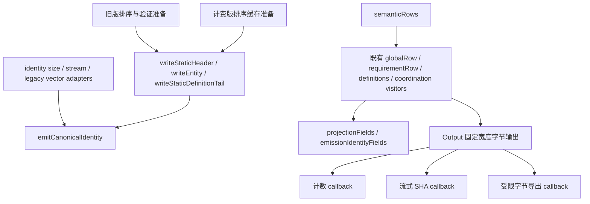
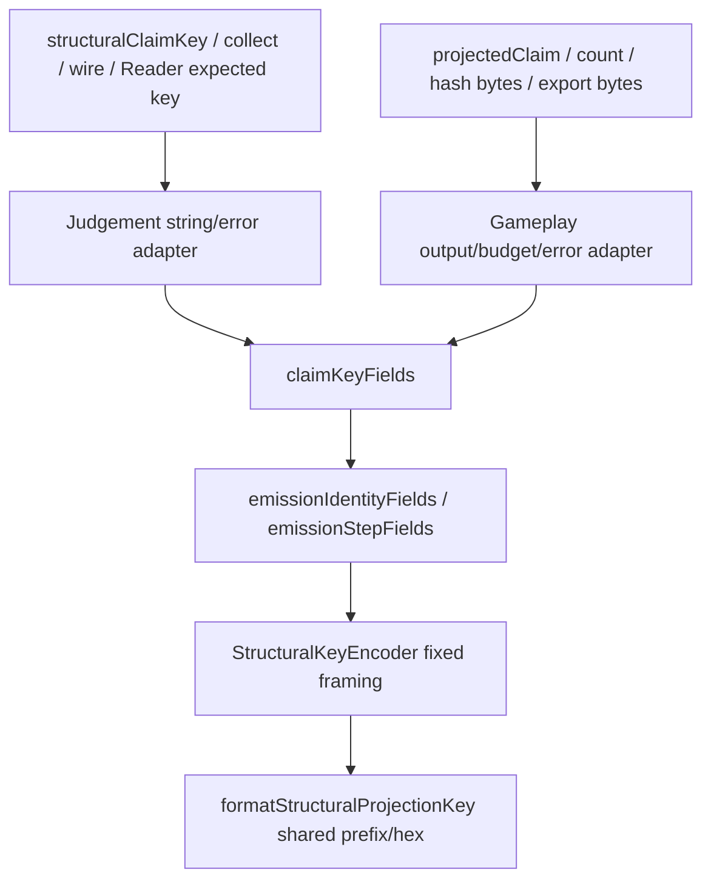

# PD-5 Capsule revision 4 阶段 B 实施记录

状态：active

更新日期：2026-10-22

快照日期：2026-10-22。本报告记录 owner 接受
[B0](2026-10-22-gameplay-admission-b0-budget-ruling.md) 后的阶段 B；当前状态归
[CURRENT_STATUS](../../../../../../../CURRENT_STATUS.md)。起点 d7ed545，开工留档 3442dfb，
分支 codex/pd5-gameplay-40k-admission。历史 A/B0 报告与证据不覆盖。

## 授权与停止条件

Owner 明确接受 capsule4.hash-work.v1 的 134217728 bytes / 1000000 Ix visits /
4096 key bytes / 8388608 scratch bytes，及 B0 的完整 Ix 计数、拒绝顺序、内部 profile、
revision 4 字段差异和兼容矩阵。

只实施合同、Reader/Writer、bounded counting/hash、metadata 和相关测试。
scratch 高水位、身份一致性、旧版兼容或完整物理预算验证失败立即停止交回，不自动修补失败验证。
阶段 C 的 40k Host 功能验收、正式测量、主树合并和 SDK/公共 API 升级均未授权。
旧窗口 3 继续 STOPPED，主树 F1、C2 与历史目录不改，原七项物理预算和 1.10/15% 不变。

## 第一批：合同与内部计费基础

Capsule §13 登记 owner 接受值与完整 wire/codec/诊断合同；Packed、Gameplay 成本分层、
Chart Entry/CXC encoding 合同同步引用。实现状态明确为进行中，没有虚构 revision 4 成功。

私有 hash_work_internal.hpp 提供 accepted clamp、字面 0、无回绕的饱和 cost、key→visits→bytes
拒绝顺序与 PMR 容量账本。32-byte cost slot 布局断言；固定工作集先预留 65536 bytes；
分配前检查新旧同时保留容量，实际释放后才减账。失败用已注册 capability.budget_insufficient
及 B0 fieldPath/profile/整数 requiredAtLeast 上下文。

新建 out/build/pd5-capsule4-b-release，Release STATIC / candidate ON / warnings-as-errors ON，
metrics/trace/lifetime observer OFF，最多四并行。构建通过；第一轮基础计费与原 Capsule 测试
23 用例/1906 断言通过。第一批尚未接入正式 Reader/Writer/hash；不是实际 R4 scratch 高水位，
没有四维端到端、身份或完整新物理包络成功证据。

## 证据与后续

证据根 out/pd5-capsule4-b-20261022-d7ed545，authorization.json 固定本轮授权与停止条件；
frozen-a-packet.log / frozen-b0-packet.log 核验旧包，configure-release.log / build-profile.log /
profile-and-legacy-tests.log 保存本批原始输出。每批按提交与原始输入/产物摘要留档。

后续状态以以下交回结论为准；本轮记录不能替代正式 preparation/registration。

## 第二批：语义字段收敛审阅交回

状态：**交回审阅，分配会计核查未通过，停止继续阶段 B 接入**。基点 98198fdc。
Owner 要求先交回调用关系和 diff，并保持预算预检后才 SHA、计数不 SHA、不完整展开超限输入、
共享定义成本复用、同一操作避免重复摘要，以及完整 scratch 会计和旧版兼容。
本批没有接入 revision 4 Reader/Writer/metadata，没有进入 40k Gameplay-host 功能验收。

### 唯一字段定义与调用关系

- 静态前缀全局字段、资源闭包及实体 payload 只有共享 writer 定义。
  旧版保留原排序和父图验证准备；计费准备使用 PMR 身份 arena、排序行和 lookup。
  两种准备不各自解释或发射语义字段。
- 实体身份 tag/UUID/text/path 只有 emitCanonicalIdentity 一份遍历。
  size、stream 和旧 vector 输出是 adapter；删除独立的 identity size 公式。
- Gameplay 的字段次序只有 semanticRows 与原有行 visitor。老 preimage 和私有 stream probe
  复用它们；E 字段和 projection framing 各有一份定义。ENT0 直接查找及原 index 解引用点
  计入 Ix，单 Requirement fixture 完整计数为 12。
- **删除 ScanInput**：没有 wire 重解析计数器、占位字符串或指针长度映射。
  被删除 header 和构建失败时的 diff 已留档，不作为正式登记继续使用。
- hashBudget 增加默认 phase/origin 参数；旧调用继续得到 count/default origin，
  export 调用与声明同步。没有新增错误码或公共配置。

### 预算顺序、摘要复用与成本缓存审计

本批测试按 count callback → checkHashCost → SHA callback → 必要的 export callback 执行。
计数 callback 不持有或调用 SHA；摘要 callback 只执行一次流式 SHA，另一份 reference SHA
是测试 oracle。私有 stream probe 没有接入 Reader/Writer/metadata，**尚不提供强制预检 token
或可复用的操作结果**，不能宣称完整 revision 4 入口顺序和一次摘要已经实现。

B1 的 accepted clamp、饱和 cost、32-byte HashCostSlot 和 PMR 账本保留。
但 probe 尚未接入按唯一共享定义缓存/组合成本，仍逐次遍历被引用的定义；不能证明计数为
O(unique input + reference sites)，也不能证明超限输入在完整语义遍历前拒绝。
这两项要求尚未满足，不能用小 fixture 的成功代替。

### 分配会计核查：不通过

| 分配来源 | 当前归属与结果 |
| --- | --- |
| 固定 64 KiB 工作集 | HashScratch 先预留，与 B1 一致 |
| static prefix 的 feature/tempo/stop/resource 视图、身份 arena、排序行和 lookup | 使用调用方 PMR；增长时同时保留的新旧容量均计费 |
| identity size/stream 标量及小字节数组 | 无完整 identity 临时 vector，属于固定工作集 |
| Pattern 遍历 result/pending 缓存 | PMR 计费；尚非 B0 设计的按深度分页 frame，未完成极端深度验证 |
| 受限导出 vector | 测试使用同一 PMR，写入前检查 export 上限，不足一 byte 的拒绝通过 |
| makeModel 深拷贝 chart/graph、定义整理、索引及校验临时容器 | **未纳入 hash scratch**，probe 每次调用仍创建，不能称为借用输入 |
| legacy projection/optionalRef/Capability/merged-row 临时复制 | **尚未逐项改为借用或完成计费**，key 预检不能代替分配闭合 |

PMR high-water 仅表示已接入部分，**不能证明全部哈希工作集 ≤ 8 MiB**。
会计核查不通过即停止接入，不放宽 envelope，不把模型复制称为 input 来排除计费。
后续需要借用同一份已验证且不变的输入，建立操作上下文、唯一成本缓存及单一摘要结果；
这是后续边界，不在本次交回中宣称完成。

### 验证与证据

Release STATIC / warnings-as-errors 构建。格式整理前 Capsule 25 用例 / 1966 断言、
Chart 227 用例 / 42425 断言通过；包括既有 revision 2/3 artifact/preimage golden、互拒、
错误输入、事务保留与 Graph 回归。新测试覆盖 count/SHA/export 同一字节串、显式和生成身份
prefix、完整 Ix 12 及受限 export 拒绝。这证明已覆盖行为兼容，不是任意多错误组合拒绝顺序
的完备证明，也不是完整新预算验收。

新证据目录：out/pd5-capsule4-b-20261022-d7ed545/convergence。
before-convergence.diff、移除的 hash_count_input_internal.hpp、各轮 build 和原始测试输出保留。
早期模板、参数和构造器编译错误均留档。格式整理后的最终输出与绑定见 final-* 日志及
binding.json；最终 diff 见 convergence.diff。
A 的 6161 个文件和 B0 的 32 个文件再次按原 packet 校验通过，旧报告文案仍是历史快照。
主工作树核对为干净 F1 eed36648，未写入历史测量目录。

未启动 C、正式测量、主树合并或 SDK/公共 API 升级；旧窗口 3 继续停止，七项物理上限及
1.10/15% 不变。本轮停在此交回点。

## 审阅补正：Claim key/E 共用字段与 framing

基点 f310df2。Owner 指出该快照仍有一处重复：hash 分支通过 projected 编码 Claim key，
collect/wire/Reader 通过 Judgement structuralClaimKey 手写 namespace/E。
输出虽一致，字段或 framing 变更仍需同步两处。本次仅修复这个维护性问题，阶段 B 接入
保持停止；前述模型分配会计、共享成本缓存及强制预检/摘要复用三项阻塞继续保留。

新增 Judgement 私有 structural_key_codec_internal.hpp：

- emissionIdentityFields / emissionStepFields 是 E（RequirementIdentity）的唯一字段顺序。
  Gameplay 的物理 Reader/Writer 仍由自己的 archive 解释 index/varint；hash 下的 E 使用
  StructuralKeyEncoder 的固定宽度 framing。
- claimKeyFields 唯一定义 Claim 前导 tag、namespace 和 E 的组合。
  structuralClaimKey 与 projectedClaim 均通过它发射字段，后者的计数/字节输出复用同一 emit。
- StructuralKeyEncoder 唯一定义小端数值、u32 文本长度、路径数量及 u64 repeat index。
  structuralProjectionKeySize 和 formatStructuralProjectionKey 共用前缀、长度计算与小写 hex；
  key 预算预检也调用这一长度函数，不能再与实际输出各维护一套 framing。

适配保留：Judgement 的 text 为原样字节，不新增 UTF-8 校验；u32/hex 超限仍使用原
length_error 文案。Gameplay 保留 UTF-8 拒绝、packed.field.wire_range、原物理 section
上限，以及私有 probe 4096-byte key 的 capability.budget_insufficient 预检。
编码层无 SHA，未改变先 count/check 后 SHA 的测试顺序，也未新增生产 R4 入口。

Release / warnings-as-errors 构建通过。Judgement 216 用例 / 35624 断言、Capsule 25 用例 /
1966 断言通过，含旧 revision 2/3 artifact/preimage golden、Reader 互拒及既有拒绝回归。
新增独立 Claim golden 固定 NUL、UTF-8、空文本、路径计数和 repeat index=256 的字节；
覆盖字段拼接不歧义、key 长度界限/无回绕，以及调用方范围错误在写入前拒绝。
这些结果限于本次重构及已覆盖的兼容场景，不代表完整 scratch 预算验收。

原始证据另存 out/pd5-claim-key-convergence-20261022-f310df2；start.json 记录干净起点并
校验上一批 32-file packet，build.log / judgement-tests.log / capsule-tests.log 为原始输出。
本批 diff、构建绑定及只读复核随该证据包留存，不覆盖上一批或 A/B0 冻结证据。

## 从 865ce98 继续：有界计数与摘要核心

本轮起点为干净 865ce985996d199c40036d7f16733c33dc9acf1a，开工留档为
b7900f6c323f50b587ae9d1003f758d803d108fb。只交回内部核心，不接 revision 4 正式
Reader/Writer/Header/metadata 入口。前文三项阻塞在本轮按同一操作输入/工作区处理；
完整 revision 4 物理包络、40k Gameplay-host 功能验收、正式测量、合并均不在本轮结论中。
四维 accepted ceiling、原七项物理预算、旧 golden、F1、1.10/15% 与窗口 3 停止状态不改。

### 调用关系与唯一字段定义

`calculateSemanticHash(SemanticInput, HashOptions)` 是新核心的唯一操作入口：

1. 借用已验证、操作期间不变的 canonical source tables、Ix、owner 和 relation-resource 索引。
   不调用 makeModel，不复制 graph/Pattern/Measure，也没有 ScanInput wire 重解析、占位字符串
   或指针长度映射。表中 linked RequirementRecord 的冗余副本和 provenance 不是此 codec 输入；
   定义 spans 与 Ix 表才是权威投影。此 view 不是一个已完成的生产入口适配器。
2. 经同一 HashScratch 预检并分配数值 cost cache 与可选导出容量，预计唯一 E/I 成本。
   原 Gameplay row visitors 同时服务旧 Reader/Writer 与新 count/hash；静态 prefix 仍通过
   streamStaticPreimage 的共用字段 writer；实体 I 仍通过同一 canonical identity encoder。
3. Count 的 Ix 边先计 1，再取得唯一表项的缓存成本，以 checked/saturating 加法组合。
   memo 命中不扣除逻辑重复 B/V；所有定义包括未使用定义仍计顶层完整行。GRC 的 owner
   引用只展开 E，resource 引用只展开 ID，保留 B0 的角色口径。Pattern 按声明树迭代遍历，
   不展开 repeat 语言。缓存只保存 B/V/K 和状态，不保存子摘要或拼接摘要。
4. key、visits、preimage 完整 cost 检查通过后才创建 SHA 对象。scratch/结构安全可以早拒。
   Count 没有 SHA sink；write 同时要求 budgetAccepted、非 counting 与已创建 SHA。
5. 同字段 writer 实际流式发射 prefix、定义和每次引用。projection 先用缓存 E/共享 framing
   求长度，再以固定 hex chunk 输出；不建完整 key、prefix 或大 preimage vector。
   实际 B/V/K 与 count 对账后 finish 一次，返回可复用 digest/cost 与可选小规模导出。
   Header/metadata 后续应使用该结果；本轮没有接线，也不把两次数组读取描述成入口已实现。

Claim key/E 继续共用 emissionIdentityFields、claimKeyFields、StructuralKeyEncoder 和
prefix/size/hex。Judgement 保留原字节与 length_error 适配，Gameplay 保留自己的预算/错误适配。
SemanticInput 的 2/3 是 Gameplay.1/.2 的语义选择器，不是新 wire dispatcher；wire 4 到
Gameplay.2 的正式映射留待下一批。

### 完整工作区清单与控制边界

按请求 capacity 计同时存活峰值，含迁移时旧/新两块；不是 RSS/CRT 分配器头开销的度量。
所有动态 workspace 经同一 HashScratch，在上游分配前 charge，失败/异常展开后 release。

| 分配或固定工作集 | 实际路径与记账 |
| --- | --- |
| 借用 source graph/definitions/Ix/entities/owners/profiles | 既存、已验证、保持不变的输入；核心不构造副本。未来入口新建的 hash 专用适配空间不得冒充输入 |
| 数值 cache | 一次 PMR resize，32*Q；Q=1+11 类实际行之和，含 E、I、全部定义和 Claim；只有数值/状态，先检查 Q 再分配 |
| prefix features、tempos、stops 排序视图 | PMR 指针数组，按实际 capacity*8（本机 x64），Count/Hash 各调用共享 writer；不持有文本副本 |
| prefix derived/declared resource 排序视图 | PMR PrefixResource，string_view+kind；所有增长的新旧容量同时计费，排序/unique 不使 capacity 免计费 |
| prefix identity key arena | PMR byte vector，所有唯一 I 的实际 canonical byte 容量；这是有界排序索引，不是完整 prefix/preimage |
| prefix entity 排序及 parent/owner 标志 | PMR PrefixEntity 数组，布局断言 <=32 bytes/entry；parent/owner 通过已计费的可复用 PMR lookup byte vector 定位 |
| Pattern 显式遍历栈 | HashFrame=16 bytes；255 个 inline frame 计入固定工作集；溢出页严格 4096 bytes/page、255 frame/page，分配前检查，出栈即归还 |
| 必要小规模字节导出 | HashOptions 只接受容量请求；核心自行通过 scratch 分配，无调用方预分配窗口。整个容量计费，存在的 0 为字面 0；容量也收紧 B，不足在 SHA 前拒绝 |
| 导出返回所有权 | 成功时唯一 allocation 从 workspace 转移到 result；峰值/分配次数保留，返回后仅 result 持有，deleter 使用原上游而非已销毁账本。上游生命周期契约同 PMR 容器 |
| ledger/operation/outputs/primitive/E/projection/hex/SHA/sort 调用栈 | 65,536-byte 固定控制额度。HashCoreWork 布局断言 <8192，hex chunk 固定 1024，SHA 无动态分配；Pattern 深度不进入 C++ 调用栈 |
| 失败诊断与异常控制 | 固定控制额度中保守覆盖；上下文只有固定字段/短整数，不复制攻击 key。测试检查诊断值长度、保留容量与额外峰值；拒绝控制额度本身时在工作开始前返回有界诊断 |
| legacy ByteWriter/owning projection/set/map/model | 新操作不进入这些分配路径；Output 的 owning writer 保持零容量。保留它们是旧版本行为路径，不是第二套新语义字段定义 |

受控观测使用 tests/pd/pd_allocation_probe.hpp 的既有全局 C++ new/delete 钩子，另设透明
ObservableResource 将 PMR 的相同容量/对齐请求转到该钩子；普通 vector 与 aligned new 是独立
正控制。实际生产默认上游不改。每个成功操作都要求全局 allocation count/bytes 与账本记录
完全相等、全局 heap peak+65536 等于 scratch peak，返回后只有明确导出容量可保留。
因此不是只看部分 PMR high-water。失败另将有界诊断归入固定控制额度；CRT allocator/EH
bookkeeping 不冒充被 C++ new 钩子逐项观测到的 payload，也不被当成语义 workspace。
实际 OOM 保持 bad_alloc 内部失败策略，不伪报 capability budget；注入每个分配位置检查清理。

### 验证设计与原始记录

新增 hash_core_tests 覆盖：

- revision 2/3 的单 Requirement、合法空图与 N=64 混合 observe/consume/claim 输入先通过旧 prepare/Writer/Reader，再逐字节等于原 semanticPreimage；N=64 的 E 长度不同，count B=实际 bytes，原 SHA 相等；
  result digest 可重复读取，不重算；输入地址/身份不变。
- 四维等号、收紧一单位、字面 0、UINT64_MAX 放宽后 min-clamp；原 checked 加乘溢出测试保留。
  实际 vector reserve 的旧+新 capacity 同时存活峰值及失败后旧内容保持。
- 单个 10,001-node 共享 Choice 被 1,000 个 Requirement 引用，Count 仅访问一份定义，
  放大原像超限时没有 hash node/SHA；没有先遍历约一千万个展开节点。
- 999 Requirement、991 个短 Binding 的密集引用构成精确 1,000,000 Ix，memo hits 仍全计。
  增加一个合法引用在 SHA 前拒绝；不以 bytes 预算掩盖 visits。
- Claim key 精确 4096，增加 namespace byte 后 4098 在 SHA 前拒绝；保留共享 E/framing。
- 20,000 层单分支 Choice 接受并对账；530,000 层在增加下一页前拒绝 scratch，SHA=0。
  Choice 包装不展开语言；没有新设固定 Pattern 深度上限。
- 合法非空 grade token 的共享 Measure，在单份 token <8MiB 时构成精确 134,217,728
  semantic bytes，实际 SHA 只流式读取源字段；再多 1 byte 在 SHA 前拒绝。无大导出请求。
- 8,192 实体的静态 prefix/生成身份/排序缓存，先经未改的 legacy Writer 七预算验证，
  新核心再与旧 preimage 的摘要/长度比较，并执行全局分配对账。
- 所有 count/hash 分配位置的 OOM 注入，含导出，检查无泄漏且不伪报预算；拒绝没有 SHA
  update/export；失败诊断不包含攻击字符串。这些是内部合成 typed-table 单测，不是 40k Host 验收。

本批证据根 out/pd5-hash-core-20261022-865ce98；start.json 校验前批 19 个 payload。
开发构建/测试、编译失败与观测器失败全部留原始日志。默认 PMR 在本机未被全局 new 钩子捕获，
所以补透明可观测上游；没有调整账本断言来掩盖差异。补充布局观测字段后又发现增量构建依赖
#deps=0、msvc_deps_prefix 乱码，新测试误连旧库；test-layout.log 的字段错位数据作废，
不作为预算/身份结论。VSLANG=1033 单独未改变本机输出；改用证据目录中的
showincludes-override.cmake（CMAKE_USER_MAKE_RULES_OVERRIDE）校正实际 UTF-8 前缀，
不修改仓库构建规则。开发重建的真实依赖已为 #deps=75，包含本批所有关键私有头。最终再用
新目录 fresh+clean-first，固定源码/二进制清单后核验。最终结果由下节及证据 receipt 登记，不以开发快照替代。

独立审阅针对首个固定候选 0c985ec：Standards 无硬性违规，提出一个旧 sink-only 探针残留
的维护性发现；Spec 无实现发现，指出多 Requirement/observe/consume/claim/空图独立 oracle
的验证缺口。前者已删除，后者已补充真实合法源，经未改旧入口往返后比较；不再保留第三种
预算探针模式。新增测试夹具最初的空图 META feature closure 与 observe Hold 不合法，旧入口
正确拒绝；仅修正夹具为正确 closure、zero-grace observer Tap，未调整产品拒绝规则或 golden。
最终复核另行登记。

### 本轮固定提交与最终核验（仅内部核心）

最终实现提交为 fa497faf045bf461142f50ef4e0792e347800b72；从 865ce98 的完整差异为
bounded-core.diff。source-tree.zip 保存编译器实际读取的 2,038 个 tracked 文件字节，
source-inventory.json 逐项 SHA-256；binary-binding-before-tests.json 在运行前固定三个 exe、
六个静态库与 CMakeCache/build.ninja/rules.ninja/compile_commands，运行后再次核对全部文件。
本报告交回提交只更新报告与 CURRENT_STATUS，不改变该实现/二进制绑定。

最终独立构建目录 out/build/pd5-hash-core-final-release-r2 使用 Release、STATIC、
WARNINGS_AS_ERRORS=ON、CHART_V5_CANDIDATE=ON；METRICS_TEST_ONLY 与 TRACE_HARNESS 均 OFF，
IMPLEMENTATION_SHA 明确等于 fa497fa。执行 fresh configure + clean-first 三个相关测试目标，
全部退出 0；实际 UTF-8 showIncludes 前缀正确，capsule 对象 #deps=75，包含 hash core/work、
semantic stream、Claim/E 共享 codec 私有头。证据保留 override 输入、配置/编译日志及构建快照。
早先 0c985ec 的 fresh 目录没有作为最终验收构建；失效增量日志也未替换成通过日志。

| 最终 Release 验证 | 结果 |
| --- | --- |
| cuexis_gameplay_packed_tests（含原 golden、拒绝行为、新 core/overflow） | 36 cases / 3,242 assertions，全通过 |
| cuexis_judgement_tests（含共享 Claim/E） | 216 cases / 35,624 assertions，全通过 |
| cuexis_chart_tests（含静态 prefix/旧格式） | 227 cases / 42,425 assertions，全通过 |
| cuexis_architecture_tests | 1/1 通过 |
| tools/check_docs.py | 476 Markdown / 20 candidate 文件通过 |
| git diff --check | 通过 |
| 全仓 cuexis_format_check | 退出 1：14 个文件的既有格式问题，全部 git blob 与 865ce98 相同 |
| 本批全部 10 个 C++ 改动文件，同一个 clang-format 的 --dry-run --Werror | 退出 0 |

format-disposition.json 列出全部 14 个旧文件及 base/final blob、检查工具版本和本批文件清单；
final-r2-format.log 保留全量失败输出，没有将全仓格式门禁记作通过，也没有扩展改动修整历史文件。
此结果是本地 Windows/MSVC 相关回归，不是 Linux sanitizer/coverage、全仓 CTest 或发行接受。
旧 golden、旧七项物理预算与拒绝规则没有更新。

### 最终分配/放大观测

allocation-observations.json 从 final-r2-capsule-tests.log 原始 23 行受控观测提取；
每个成功样本都已核对 global count/bytes 等于 ledger count/bytes、global peak+65536
等于 scratch peak、workspace live=0、sha=1、sha.bytes=B。没有导出时返回保留为 0；
有导出时仅保留账本已收费的结果容量。HashCoreWork 实测 sizeof=4624，含在固定控制额度内。
不能把“累计 allocations bytes”误当成同时存活峰值，或把失败诊断保留误当成 hash cache。

| 对抗/边界样本 | B / V / K | scratch 峰值 bytes | 关键观测 |
| --- | --- | ---: | --- |
| 共享 Measure 精确 preimage ceiling | 134217728 / 342 / 260 | 69272 | 25 次、4774 累计动态请求 bytes；heap peak=3736；无导出，SHA bytes 精确相等 |
| 上述再增 1 semantic byte | 拒绝 preimage | 69272 | nodes.count=1；nodes.hash=0，SHA=0 |
| 共享 10001-node Pattern ×1000 引用 | 拒绝 preimage | 162232 | Count node=10001，memo hits=8000；hash node/SHA=0 |
| 密集短引用等号 | 48010731 / 1000000 / 260 | 193816 | 997002 cache hits 仍计逻辑 Ix；SHA 一次 |
| 密集短引用增加一个边 | 拒绝 visits | 193848 | SHA=0 |
| Claim key 等号 | 16253 / 12 / 4096 | 66328 | 共享 framing/hex 流式输出 |
| Claim key 多一个 namespace byte | 拒绝 key（4098） | 66328 | SHA=0 |
| 深 Pattern 20000 | 207827 / 12 / 276 | 385568 | Count nodes=20000，hash nodes=40000，无递归堆栈展开 |
| 深 Pattern 530000 | 拒绝 scratch | 8385056 | 下一页分配前拒绝；SHA=0；没有上调 8388608 |
| 8192 静态实体身份/排序 | 995985 / 12 / 276 | 1056424 | 65 次、3688358 累计动态请求 bytes；heap peak=990888；与旧 preimage 摘要相等 |

小输入四维 exact requests 均通过；各维收紧 1、字面 0 均在 SHA 前拒绝；UINT64_MAX 请求
仍按 accepted ceiling clamp，与原 digest 相同。export exact 成功、少 1/0 在 SHA 前拒绝，
UINT64_MAX capacity 在分配前拒绝 scratch。checked 加乘溢出与拒绝顺序测试通过。
真实 PMR vector 1024→2048 迁移以 65536+3072 为等号峰值；少 1 在调用上游前拒绝，旧内容
与地址保持。600 深度输入含/不含导出的每个 count/hash allocation 位置均注入 bad_alloc，
全部释放，未改称 budget；预算失败 workspace live=0、SHA/update/export=0，诊断保持有界。

独立 legacy oracle 覆盖 revision 2/3 的单 Requirement、合法空图与 N=64 混合 intent：
逐字节等于旧 semanticPreimage，count=导出长度，digest=原 SHA；N=64 的 Ix=705，
Gameplay.1 B=133997、Gameplay.2 B=144363。empty 分别 B=1889/1935、Ix=0。
不借助新 core 反向生成 oracle；source prepare→原 Writer→原 Reader 先通过再借用输入。
完整原 Capsule/Judgement/Chart 回归同步通过，旧 golden 未改。

### 独立 Standards 复核

最终固定范围 865ce98..fa497fa，补查 0c985ec..fa497fa：硬性违规 0、可行动异味 0。
原 sink-only 探针残留已删除；测试夹具在观测窗口外，报告保留非法夹具拒绝和构建依赖问题。
该轴为只读代码复核，没有自行构建，不替代上述最终同 SHA 证据。

### 独立 Spec 复核

最终固定范围 865ce98..fa497fa：新增实现发现 0。原多 Requirement/混合 intent/不同 E 长度/
空图 oracle 缺口已关闭，经旧入口往返再比较完整 bytes/长度/SHA/Ix。删除 sink-only 分支
保留 operation 分支和共享字段定义，不改旧入口语义；仍限内部核心，未接 revision 4。
该轴同为只读设计复核；最终构建/测试由本报告原始记录提供。

两轴未关闭发现均为 0；全仓格式失败另按上表原样交回，不混入复核发现计数。

### 冻结证据与交回边界

最终只读重验 Stage A packet 6161 文件、B0 packet 32 文件及上一批 Claim-key packet 19 payload
全部哈希不变。B0 verify 脚本中的“pending/stopped”是冻结时点文字，不覆盖后来的 owner 接受。
主工作树仍为干净 F1 eed36648a692333e47f798aa45be36ca850d08de。
本批证据 packet 的 receipt.json 登记最终报告提交、源码提交、二进制/原始日志/index/zip 绑定；
verify_packet.py 只读复核完整性，不等于 owner 对实现或阶段 B 的接受。

本轮完成后停止并交回 owner 核验。revision 4 正式 Reader/Writer/Header/metadata 入口接入、
完整 revision 4 七项物理预算联合验收、阶段 C、正式 performance preparation/registration/
measurement、主树合并与 SDK/公共 API 升级均未执行。旧窗口 3 继续停止；F1 比较基线、
1.10/15%、四维 envelope、原七物理预算、旧 golden 与所有生命周期规则保持。
