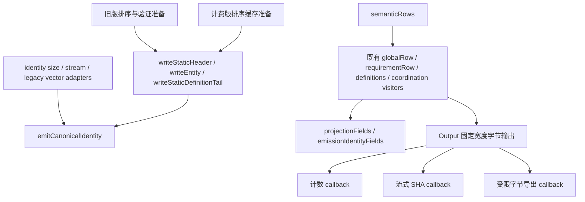

# PD-5 Capsule revision 4 阶段 B 实施记录

状态：active

更新日期：2026-10-22

快照日期：2026-10-22。本报告记录 owner 接受
[B0](2026-10-22-gameplay-admission-b0-budget-ruling.md) 后的阶段 B；当前状态归
[CURRENT_STATUS](../../../../CURRENT_STATUS.md)。起点 d7ed545，开工留档 3442dfb，
分支 codex/pd5-gameplay-40k-admission。历史 A/B0 报告与证据不覆盖。

## 授权与停止条件

Owner 明确接受 capsule4.hash-work.v1 的 134217728 bytes / 1000000 Ix visits /
4096 key bytes / 8388608 scratch bytes，及 B0 的完整 Ix 计数、拒绝顺序、内部 profile、
revision 4 字段差异和兼容矩阵。

只实施合同、Reader/Writer、bounded counting/hash、metadata 和相关测试。
scratch 高水位、身份一致性、旧版兼容或完整物理预算验证失败立即停止交回，不自动修补失败验证。
阶段 C 的 40k Host 功能验收、正式测量、主树合并和 SDK/公共 API 升级均未授权。
旧窗口 3 继续 STOPPED，主树 F1、C2 与历史目录不改，原七项物理预算和 1.10/15% 不变。

## 第一批：合同与内部计费基础

Capsule §13 登记 owner 接受值与完整 wire/codec/诊断合同；Packed、Gameplay 成本分层、
Chart Entry/CXC encoding 合同同步引用。实现状态明确为进行中，没有虚构 revision 4 成功。

私有 hash_work_internal.hpp 提供 accepted clamp、字面 0、无回绕的饱和 cost、key→visits→bytes
拒绝顺序与 PMR 容量账本。32-byte cost slot 布局断言；固定工作集先预留 65536 bytes；
分配前检查新旧同时保留容量，实际释放后才减账。失败用已注册 capability.budget_insufficient
及 B0 fieldPath/profile/整数 requiredAtLeast 上下文。

新建 out/build/pd5-capsule4-b-release，Release STATIC / candidate ON / warnings-as-errors ON，
metrics/trace/lifetime observer OFF，最多四并行。构建通过；第一轮基础计费与原 Capsule 测试
23 用例/1906 断言通过。第一批尚未接入正式 Reader/Writer/hash；不是实际 R4 scratch 高水位，
没有四维端到端、身份或完整新物理包络成功证据。

## 证据与后续

证据根 out/pd5-capsule4-b-20261022-d7ed545，authorization.json 固定本轮授权与停止条件；
frozen-a-packet.log / frozen-b0-packet.log 核验旧包，configure-release.log / build-profile.log /
profile-and-legacy-tests.log 保存本批原始输出。每批按提交与原始输入/产物摘要留档。

后续状态以以下交回结论为准；本轮记录不能替代正式 preparation/registration。

## 第二批：语义字段收敛审阅交回

状态：**交回审阅，分配会计核查未通过，停止继续阶段 B 接入**。基点 98198fdc。
Owner 要求先交回调用关系和 diff，并保持预算预检后才 SHA、计数不 SHA、不完整展开超限输入、
共享定义成本复用、同一操作避免重复摘要，以及完整 scratch 会计和旧版兼容。
本批没有接入 revision 4 Reader/Writer/metadata，没有进入 40k Gameplay-host 功能验收。

### 唯一字段定义与调用关系

- 静态前缀全局字段、资源闭包及实体 payload 只有共享 writer 定义。
  旧版保留原排序和父图验证准备；计费准备使用 PMR 身份 arena、排序行和 lookup。
  两种准备不各自解释或发射语义字段。
- 实体身份 tag/UUID/text/path 只有 emitCanonicalIdentity 一份遍历。
  size、stream 和旧 vector 输出是 adapter；删除独立的 identity size 公式。
- Gameplay 的字段次序只有 semanticRows 与原有行 visitor。老 preimage 和私有 stream probe
  复用它们；E 字段和 projection framing 各有一份定义。ENT0 直接查找及原 index 解引用点
  计入 Ix，单 Requirement fixture 完整计数为 12。
- **删除 ScanInput**：没有 wire 重解析计数器、占位字符串或指针长度映射。
  被删除 header 和构建失败时的 diff 已留档，不作为正式登记继续使用。
- hashBudget 增加默认 phase/origin 参数；旧调用继续得到 count/default origin，
  export 调用与声明同步。没有新增错误码或公共配置。

### 预算顺序、摘要复用与成本缓存审计

本批测试按 count callback → checkHashCost → SHA callback → 必要的 export callback 执行。
计数 callback 不持有或调用 SHA；摘要 callback 只执行一次流式 SHA，另一份 reference SHA
是测试 oracle。私有 stream probe 没有接入 Reader/Writer/metadata，**尚不提供强制预检 token
或可复用的操作结果**，不能宣称完整 revision 4 入口顺序和一次摘要已经实现。

B1 的 accepted clamp、饱和 cost、32-byte HashCostSlot 和 PMR 账本保留。
但 probe 尚未接入按唯一共享定义缓存/组合成本，仍逐次遍历被引用的定义；不能证明计数为
O(unique input + reference sites)，也不能证明超限输入在完整语义遍历前拒绝。
这两项要求尚未满足，不能用小 fixture 的成功代替。

### 分配会计核查：不通过

| 分配来源 | 当前归属与结果 |
| --- | --- |
| 固定 64 KiB 工作集 | HashScratch 先预留，与 B1 一致 |
| static prefix 的 feature/tempo/stop/resource 视图、身份 arena、排序行和 lookup | 使用调用方 PMR；增长时同时保留的新旧容量均计费 |
| identity size/stream 标量及小字节数组 | 无完整 identity 临时 vector，属于固定工作集 |
| Pattern 遍历 result/pending 缓存 | PMR 计费；尚非 B0 设计的按深度分页 frame，未完成极端深度验证 |
| 受限导出 vector | 测试使用同一 PMR，写入前检查 export 上限，不足一 byte 的拒绝通过 |
| makeModel 深拷贝 chart/graph、定义整理、索引及校验临时容器 | **未纳入 hash scratch**，probe 每次调用仍创建，不能称为借用输入 |
| legacy projection/optionalRef/Capability/merged-row 临时复制 | **尚未逐项改为借用或完成计费**，key 预检不能代替分配闭合 |

PMR high-water 仅表示已接入部分，**不能证明全部哈希工作集 ≤ 8 MiB**。
会计核查不通过即停止接入，不放宽 envelope，不把模型复制称为 input 来排除计费。
后续需要借用同一份已验证且不变的输入，建立操作上下文、唯一成本缓存及单一摘要结果；
这是后续边界，不在本次交回中宣称完成。

### 验证与证据

Release STATIC / warnings-as-errors 构建。格式整理前 Capsule 25 用例 / 1966 断言、
Chart 227 用例 / 42425 断言通过；包括既有 revision 2/3 artifact/preimage golden、互拒、
错误输入、事务保留与 Graph 回归。新测试覆盖 count/SHA/export 同一字节串、显式和生成身份
prefix、完整 Ix 12 及受限 export 拒绝。这证明已覆盖行为兼容，不是任意多错误组合拒绝顺序
的完备证明，也不是完整新预算验收。

新证据目录：out/pd5-capsule4-b-20261022-d7ed545/convergence。
before-convergence.diff、移除的 hash_count_input_internal.hpp、各轮 build 和原始测试输出保留。
早期模板、参数和构造器编译错误均留档。格式整理后的最终输出与绑定见 final-* 日志及
binding.json；最终 diff 见 convergence.diff。
A 的 6161 个文件和 B0 的 32 个文件再次按原 packet 校验通过，旧报告文案仍是历史快照。
主工作树核对为干净 F1 eed36648，未写入历史测量目录。

未启动 C、正式测量、主树合并或 SDK/公共 API 升级；旧窗口 3 继续停止，七项物理上限及
1.10/15% 不变。本轮停在此交回点。
